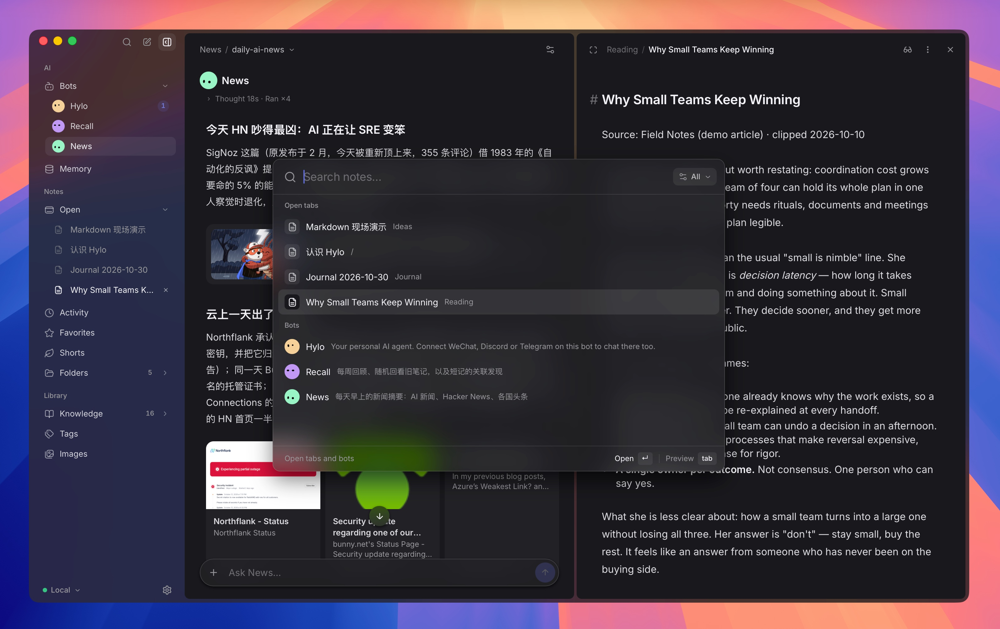

# Hylo

**Your notes. Your context. Your AI.**

Hylo is a notes app with a Personal AI built in. You write; AI compiles your notes into context about you; your own AI uses that context to work for you. All your data stays on your own machine.

[中文文档](./README_ZH.md)



## Your notes

A complete notes app, and every note file belongs to you.

- **Write and capture.** A WYSIWYG Markdown editor, Shorts for passing thoughts, instant search, and a browser extension that saves any page as Markdown.
- **No lock-in.** Share the same vault with Obsidian, open it in any editor, and if you ever leave Hylo, your notes leave with you unchanged.

## Your context

Scattered notes are hard for an AI to use. Hylo has AI compile them into structured context that it can actually work with:

- **Knowledge wiki.** Notes and web clips become linked knowledge units under `/_knowledge/`: a map of your knowledge, as an LLM wiki.
- **Personal memory.** Who you are, what you're after, what you believe, the people around you, what you're doing now, how you write. Kept in `/_memory/` and updated as you write.

Personal context is the most private data you have. Here it is Markdown in your own vault: you can read it, correct it, and no AI vendor keeps it for you.

## Your AI

A personal AI that knows you and works for you, not for a platform.

- **Knows you.** Every conversation starts with your memory and knowledge, so you never have to explain yourself again.
- **Works for you.** Bots act on their own when notes arrive or on a schedule: compiling what you clip, updating your memory, bringing old notes back. Add skills and they go further, like picking the news you'll care about. Talk to them in the app or from WeChat, Discord and Telegram.
- **Not tied to a vendor.** Hylo drives the agent CLI you choose (**Claude Code, Codex, OpenCode, Cursor Agent, GitHub Copilot CLI or Pi**), and switching is a setting. Run the server on your own machine or cloud instance and it stays on with your laptop closed.

## Get started

1. **Desktop app.** Download the `.dmg` from [Releases](https://github.com/skoowoo/hylo/releases/latest). If macOS blocks it, go to **System Settings → Privacy & Security → Open Anyway**. The app installs the `hylo` CLI to `~/.local/bin`; add that to your `PATH`:

   ```sh
   export PATH="$HOME/.local/bin:$PATH"
   ```

2. **Onboarding** creates the main **Hylo** bot on your agent CLI, ready to compile clips and update your memory.
3. **Clip extension** (optional). Download `hylo-clip-*.zip` from the same page, unzip it, and load it in `chrome://extensions/` with Developer mode on.
4. **Always on** (optional). Install the server on another host and follow [Remote Deployment](./docs/remote-deployment.md):

   ```sh
   curl -sL https://raw.githubusercontent.com/skoowoo/hylo/main/install-cli.sh | sh
   ```

### Use an existing Obsidian vault

Pick the vault folder under **Settings → Server → Config → Vault** and save. Hylo initializes it automatically, adding a `.hylo/` folder and indexing your notes. Nothing else in the vault changes, and Obsidian keeps working on it as before.

## Before you start

- **Keep folders flat.** One level of category folders works best.
- **Keep filenames unique.** Wikilinks `[[name]]` point at filenames, not paths.
- **`_` folders belong to Hylo.** `_knowledge/`, `_memory/`, `_shorts/` and similar are system folders; don't start your own folder names with `_`.
- **Bring your own agent.** Install at least one of the supported agent CLIs first; Pi is recommended.

## Docs

- [Bots](./docs/bots.md): triggers, the Hylo bot, WeChat / Discord / Telegram, customizing prompts
- [Context](./docs/context.md): how the knowledge wiki and personal memory are built
- [Skills](./docs/skills.md): built-in skills, adding more from GitHub
- [Remote Deployment](./docs/remote-deployment.md): running Hylo 24/7 behind HTTPS

## Architecture

Hylo Server is one self-contained Go binary with SQLite and a full-text index built in. The desktop app, CLI, chat channels and Clip extension all talk to it over HTTP, the same way whether it runs locally or on a remote host.

```
 Desktop App   CLI   WeChat / Discord / Telegram   Clip
      └─────────┴──────────────┬──────────────────┘
                               ▼
                          Hylo Server
      ┌──────────────┬─────────┴────┬──────────────┐
  Markdown files   SQLite     Full-text index   Agent CLIs
```
