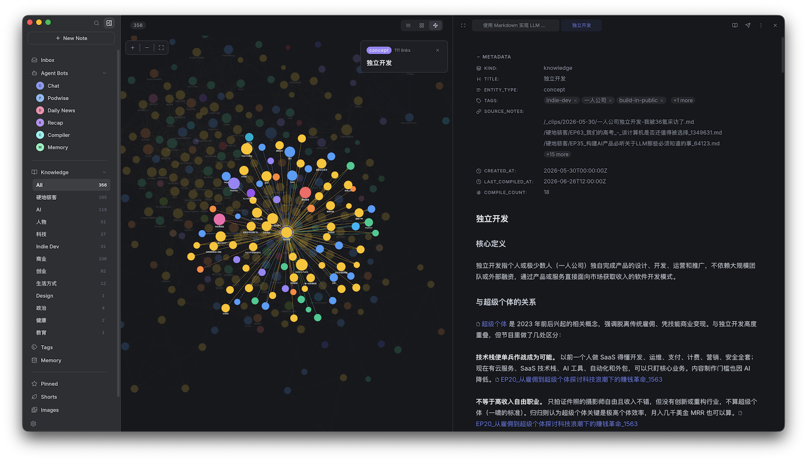
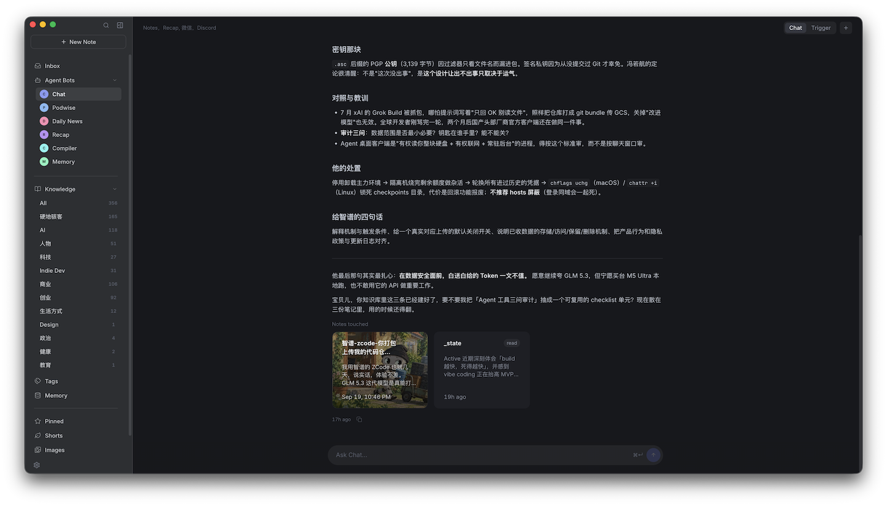
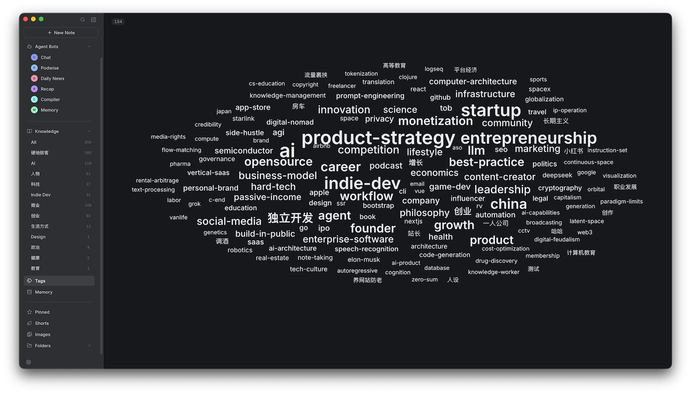
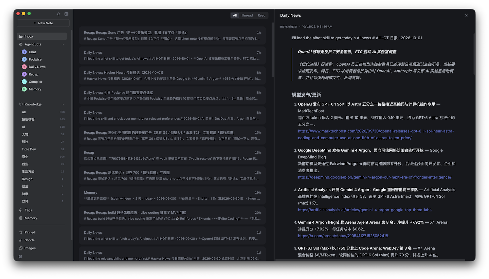
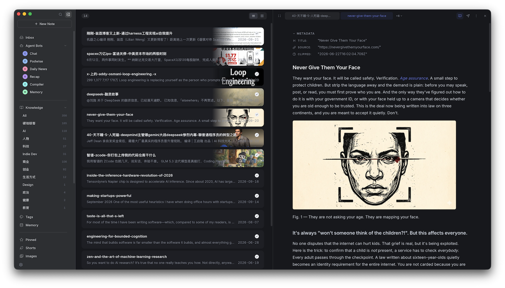
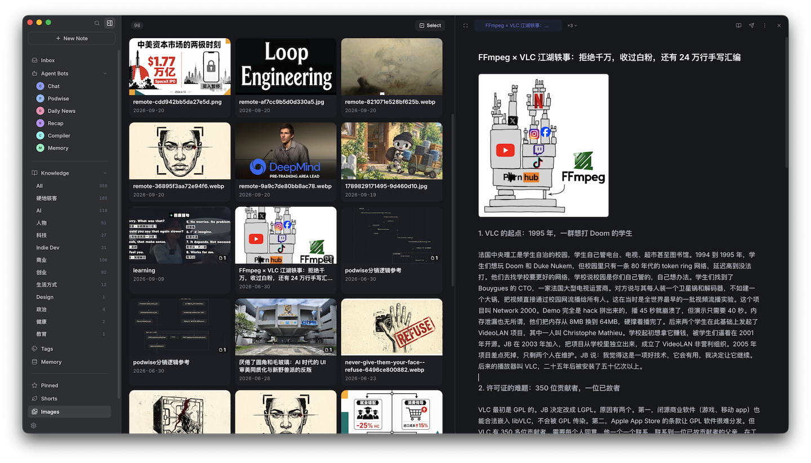
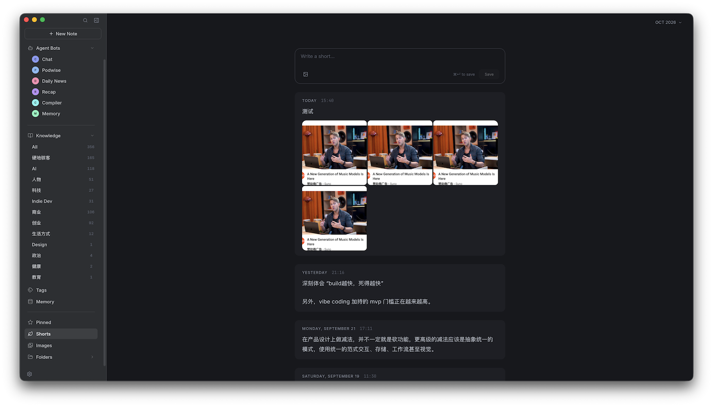
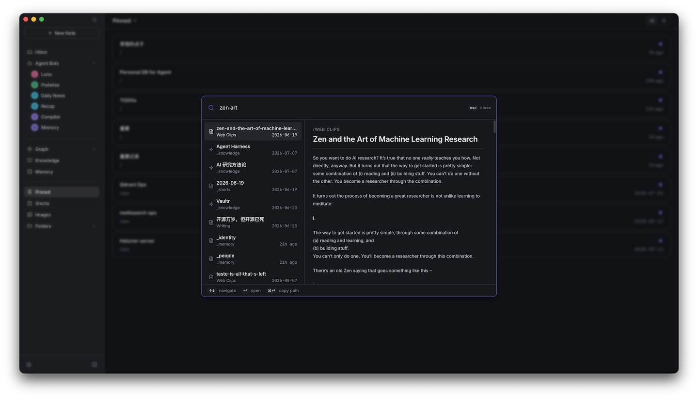

# Hylo: a personal AI agent powered by your notes. Always on, Obsidian-compatible.

You just write. Hylo learns who you are from your notes, then works for you around the clock: organizing your notes into knowledge, answering from them, and going beyond them, like picking the news you'll care about.

[中文文档](./README_ZH.md)

1. Pick a topic on the AI knowledge graph and open it in the editor to read or edit.



2. Ask the agent in chat to work on your notes.



3. A tag graph generated by AI.



4. Bots fetch news and other updates each day and send them to your inbox.



5. Read and edit clipped web pages right in the editor.



6. All images from your notes in one place. Click an image to find the notes that use it.



7. Capture quick, scattered thoughts every day.



8. Search notes as you type.



## Table of Contents

- [Highlight Features](#highlight-features)
- [Design](#design)
- [Architecture](#architecture)
- [Installation](#installation)
- [Obsidian Compatibility](#obsidian-compatibility)
- [Editor](#editor)
- [Bots](#bots)
- [WeChat](#wechat)
- [Discord](#discord)
- [LLM-Wiki Compiler](#llm-wiki-compiler)
- [Personal Memory](#personal-memory)
- [Skills](#skills) ([full guide](./docs/skills.md))
- [Customizing AI Behavior](#customizing-ai-behavior)
- [Shortcuts](#shortcuts)

## Highlight Features

#### 📝 Full-Featured Note System
- **Built-in WYSIWYG editor**: write in rich text or raw Markdown, switch anytime
- **Wikilinks and wiki images**: fully Obsidian-compatible
- **Shorts**: a daily capture stream for quick notes, accessible from anywhere
- **Instant search** inspired by Raycast: find anything as you type
- **Clip browser extension**: save any webpage as Markdown with one click

#### 🤖 Event-Driven Multi-Agent System
- **7 agent CLIs** supported out of the box
- **Event-triggered automation**: agents run tasks automatically when notes change, messages arrive, or schedules fire
- **WeChat & Discord integration**: chat with agents directly from WeChat or Discord DMs

#### 🧠 LLM-Wiki Compiler
- Compiles your notes into **structured knowledge** and builds an interconnected **LLM wiki network**

#### 🪞 Personal Memory
- Automatically extracts **personal memories** from your notes (identity, preferences, goals, beliefs, people, and current state) into structured files that stay current
- Lets your AI agents truly **know you**: every conversation carries memory instead of starting cold

#### ☁️ Always On, Self-Hosted
- Deploy Hylo on a home server or cloud instance and your agent stays **online 24/7**, even when your laptop is closed
- Scheduled bots keep running, and the agent answers on WeChat or Discord anytime
- Your data stays on a machine you own: Markdown files, SQLite metadata, full-text index. See [Remote Deployment](./docs/remote-deployment.md)

#### 🌐 Multiple Access Channels
- Available via **CLI**, **desktop app**, **WeChat**, and **Discord**

## Design

Hylo has one core idea: **you write, your agent does the rest.**

Your notes are how the agent gets to know you. What you write tells it what you're working on, what you care about, and how you think. With that, it does more than manage notes: it organizes them for you, answers from them, and works for you beyond them, like a morning news digest picked for your interests.

#### Write freely, don't manage

Hylo discourages spending energy on note maintenance: elaborate categorization, nested folder hierarchies, manual tagging, and archiving. These are low-value, repetitive chores. Taking notes should be effortless and spontaneous: just write.

Concretely, Hylo **strongly discourages nested directories**. You can create simple buckets like `/reading`, `/work`, or `/ideas`, but nesting subdirectories inside them is not recommended, though it's technically possible. Keeping things flat frees you from the mental overhead of deciding *where* every note belongs.

#### AI compiles, you don't organize

What turns raw notes into useful knowledge? Hylo's answer: hand it off to AI.

- You write short notes, journal entries, clip web pages. No curation needed.
- AI agents automatically **compile these notes into structured knowledge**, building an interconnected LLM wiki network in the knowledge base
- The knowledge base is further distilled into **personal memory**, giving every conversation context

The entire pipeline runs automatically. You don't need to be involved in any organizing work.

#### AI retrieves, you don't browse

Hylo ships full-text search, but the more important capability is letting agents retrieve on your behalf. When you need something, ask an agent directly. It searches your notes and knowledge base and surfaces the answer.

#### Always on

An agent that works for you should not stop when your laptop sleeps. Run Hylo Server on a home server or cloud instance, connect the desktop app to it, and your agent keeps working around the clock: scheduled bots run on time, and you can reach it from WeChat or Discord wherever you are.

#### ⚠️ Things you must know before using Hylo

- **Avoid nested directories.** Hylo recommends a flat, single-level directory structure. You can technically create subdirectories inside category folders, but it is strongly discouraged.
- **Keep filenames unique.** Hylo links notes using Wiki Link syntax `[[stem]]`, by filename rather than path. Duplicate filenames cause ambiguous references.
- **Underscore-prefixed directories are system-reserved.** Directories like `_knowledge/`, `_shorts/`, and `_memory/` are used internally by Hylo. Do not use an underscore prefix for your own category directories.
- **Hylo does not bundle an AI Agent.** You need an agent CLI already installed on your machine (e.g. Claude Code, OpenCode, Codex). Hylo discovers them automatically from your PATH with no extra configuration needed. See [Backing Agents](#backing-agents).

## Architecture

```
┌──────────────┐  ┌──────────────┐  ┌──────────────┐  ┌──────────────┐
│              │  │              │  │              │  │              │
│  Desktop App │  │    WeChat    │  │     CLI      │  │  Clip (Ext)  │
│              │  │              │  │              │  │              │
└──────┬───────┘  └──────┬───────┘  └──────┬───────┘  └──────┬───────┘
       │                 │                 │                 │
       └─────────────────┴─────────────────┴─────────────────┘
                                  │
                                  ▼
┌────────────────────────────────────────────────────────────────────┐
│                           Hylo Server                              │
└──────┬─────────────────┬─────────────────┬─────────────────┬───────┘
       │                 │                 │                 │
       ▼                 ▼                 ▼                 ▼
┌──────────────┐  ┌──────────────┐  ┌──────────────┐  ┌──────────────┐
│  Filesystem  │  │    SQLite    │  │    Bleve     │  │    Agents    │
│   (Markdown) │  │  (Metadata)  │  │  (FTS Index) │  │  (CLI/MCP)   │
└──────────────┘  └──────────────┘  └──────────────┘  └──────────────┘
```

**Hylo Server** is a single, self-contained Go binary with no external dependencies. It embeds SQLite and Bleve directly, so the entire server is just one executable you drop anywhere and run.

Because it's a plain HTTP server, it deploys equally well on your local machine or a remote cloud instance. Run it on a home server or a container; all clients (desktop app, CLI, WeChat bridge) connect over the network the same way.

## Installation

> **To get started:** install the Desktop App and the Clip extension. The Desktop App detects the CLI on first launch and offers one-click installation if it is not found. To keep your agent online 24/7, also deploy the Server on a remote or home host (see [Remote Deployment](./docs/remote-deployment.md)).

#### 💻 Desktop App

1. Download the latest `.dmg` file from the [Latest Release](https://github.com/skoowoo/hylo/releases/latest) page
2. Open the dmg and drag Hylo into your Applications folder
3. On first launch, macOS may block the app since it is signed but not notarized by Apple

   **Fix:** Go to **System Settings → Privacy & Security**, scroll down to find the blocked app notice, and click **Open Anyway**

4. The Desktop App installs the `hylo` CLI to `~/.local/bin/hylo`. Add this to your shell profile so agents can use it:

   ```sh
   # zsh — add to ~/.zshrc or ~/.zprofile
   export PATH="$HOME/.local/bin:$PATH"

   # bash — add to ~/.bash_profile or ~/.bashrc
   export PATH="$HOME/.local/bin:$PATH"
   ```

   Restart your terminal (or run `source ~/.zshrc` / `source ~/.bash_profile`) afterward.

#### 🧩 Browser Extension (Clip)

1. Download the latest `hylo-clip-*.zip` from the [Latest Release](https://github.com/skoowoo/hylo/releases/latest) page
2. Unzip the file
3. Open Chrome or Edge and go to `chrome://extensions/`
4. Enable **Developer mode** in the top-right corner
5. Click **Load unpacked** and select the unzipped folder
6. The extension is now installed and visible in your browser toolbar

#### ⌨️ Server & CLI

Run the following command to install the Hylo server and CLI:

```sh
curl -sL https://raw.githubusercontent.com/skoowoo/hylo/main/install-cli.sh | sh
```

To run it on a remote host behind HTTPS, follow [Remote Deployment](./docs/remote-deployment.md). Then in the Desktop App, open the server switcher → **Manage servers…** → **Add a remote server**, and paste the key from `hylo auth show` on that host.

## Obsidian Compatibility

Hylo is **fully compatible with Obsidian**. Both tools can work on the same vault at the same time, no migration required, no need to pick one over the other.

- **Same vault, same files.** Hylo reads and writes plain Markdown in your existing directory structure. Keep using Obsidian as your primary editor if you prefer.
- **Obsidian-native syntax.** Wikilinks (`[[Note]]`), aliases (`[[Page|Alias]]`), and wiki images (`![[image.png]]`) all work out of the box.
- **No format conversion.** Everything Hylo creates or modifies stays standard Markdown — open it in Obsidian and it looks exactly as you'd expect.
- **Hylo as your AI layer.** Point Hylo at your Obsidian vault and let it handle the AI side: LLM wiki compilation, personal memory, event-driven agents, WeChat, and search. You write in Obsidian; Hylo runs the automation on top.

#### Get started with an existing vault

Point `hylo init` at your Obsidian vault directory:

```sh
# Initialize the current directory
hylo init

# Or pass a path explicitly
hylo init /path/to/your/obsidian-vault
```

This creates a `.hylo/` folder inside the directory, scans all Markdown files, registers them in the metadata database, and builds the full-text search index. If `.hylo/` already exists the command exits safely without changing anything. Your Obsidian vault is otherwise untouched.

After running `hylo init`, open the **Hylo desktop app** and complete the setup:

1. Go to **Settings → Server → Config**
2. Under **Vault**, click the path field and select your vault directory
3. Save config

Your notes will now be available in Hylo — while Obsidian continues to work on the same vault as before.

## Editor

Hylo includes a built-in WYSIWYG Markdown editor. Notes open in rich-text mode by default; toggle to raw Markdown at any time with the mode button in the toolbar.

#### ✍️ Writing

The editor supports CommonMark and GFM: headings, bold, italic, strikethrough, inline code, code blocks, tables, and task lists. YAML frontmatter is preserved as-is.

#### 🔗 Wikilinks and Wiki Images

Type `[[` to insert a wikilink. Aliases follow Obsidian syntax: `[[Page Name|Alias]]`. Embed images with `![[filename.png]]`.

## Bots

Bots are custom AI agents you define in **Settings → Bots**. Each bot has a name, a system prompt, and a backing agent CLI (any agent CLI detected on your PATH).

#### 🔔 Event Triggers

Add one or more triggers to a bot and it runs automatically whenever a matching event fires. Hylo ships with these built-in events:

| Event                | When it fires                                        |
| -------------------- | ---------------------------------------------------- |
| `note_created`       | Any new note is created in the vault                 |
| `note_updated`       | Any existing note is modified                        |
| `note_deleted`       | Any note is deleted                                  |
| `short_note_created` | A short-note entry is appended                       |
| `scheduled`          | On a configured interval, daily time, or weekly time |
| `wechat_message`     | A WeChat direct message is received                  |
| `discord_message`    | A Discord DM is received                             |
| `compile_requested`  | An LLM wiki compilation is manually triggered        |

#### 🧩 The Hylo bot

The desktop app creates a **Hylo** bot during onboarding. If you skipped that, or run Hylo on a server, open **Settings → Bots**: with no bots yet, it walks you through the same setup. The bot comes with these triggers:

| Trigger                          | What it does                                                                  |
| -------------------------------- | ----------------------------------------------------------------------------- |
| `wechat_message`, `discord_message` | Replies to you on WeChat and Discord once they're connected                |
| `compile_requested`              | Compiles a note into knowledge units when you ask for it                      |
| `note_created` on `/Web Clips/`  | Compiles new web clips automatically                                          |
| `scheduled` daily 09:00          | Updates your personal memory                                                  |
| `short_note_created`             | Cross-checks each new short note against your knowledge base                  |
| `scheduled` weekly Mon 09:05     | Reviews the past week's writing                                               |

Edit or remove any of them under **Settings → Bots**, or click **New Bot** to build your own.

#### Backing Agents

> **Hylo automatically discovers available agent CLIs from your local `PATH` with no extra configuration needed.** If you already use Claude Code, Codex, or Copilot in your terminal, Hylo finds them at startup and makes them available as backing agents for your bots.

Hylo integrates **7 agent CLIs** out of the box:

- Claude Code
- OpenCode
- Codex CLI
- Cursor Agent
- Hermes
- GitHub Copilot CLI
- Pi

## WeChat

Hylo can receive WeChat direct messages and route them to a bot automatically. Setup has two steps.

#### Step 1: Connect WeChat in Server Config

1. Open **Settings → Server → Config → WeChat**
2. Click **Scan QR to log in** — a QR code appears
3. Open WeChat on your phone and scan the code; confirm when prompted
4. Once the status badge shows **Connected**, click **Save all**

The WeChat iLink bridge begins polling for new DMs.

#### Step 2: Create a Bot with a `wechat_message` trigger

1. Open **Settings → Bots** and click **New Bot**
2. Fill in a name, pick an agent and model
3. Under **Triggers**, click **+ Add trigger**
4. Set the **Event** to `wechat_message`
5. Write a prompt template:

   Example prompt:
   ```
   {Content}
   ```

6. Save the bot

From this point on, every WeChat DM fires the trigger and the bot replies automatically.

## Discord

Same idea as WeChat, but Discord. The bot connects over the Gateway and replies to DMs.

#### Step 1: Configure Discord in Server Config

1. Create a Bot at the [Discord Developer Portal](https://discord.com/developers/applications)
2. Under **Bot → Privileged Gateway Intents**, enable **Message Content Intent**
3. Copy the Bot token
4. Open **Settings → Server → Config → Discord**
5. Paste the token into **Bot token**, fill in your **Owner user ID** (Developer Mode → right-click your avatar → Copy User ID), and set **enabled** to true
6. Click **Save all** and restart the server. The Bot's status dot turns green once connected.

To send proactive DMs (e.g. from a scheduled trigger), the Bot must share at least one server with you.

If `discord.com` is not directly reachable, set **Proxy URL** to your local proxy (e.g. `http://127.0.0.1:7890`).

#### Step 2: Create a Bot with a `discord_message` trigger

1. Open **Settings → Bots** and click **New Bot**
2. Fill in a name, pick an agent and model
3. Under **Triggers**, click **+ Add trigger**
4. Set the **Event** to `discord_message`
5. Write a prompt template. Available variables: `{Content}`, `{DiscordChannelID}`, `{DiscordUserID}`
6. Save the bot

Done. Every incoming DM now triggers the bot and gets a reply.

## LLM-Wiki Compiler

Compile notes into structured knowledge units under `/_knowledge` and build an interconnected LLM wiki network automatically.

#### Step 1 — Enable the Compiler

Go to **Settings → Server → Config → Compile** and enable the compiler.

#### Step 2 — Compile with a bot

The **Hylo** bot created during onboarding already has two compile triggers:

| Trigger             | When it fires                                                                         |
| ------------------- | ------------------------------------------------------------------------------------- |
| `compile_requested` | You manually compile a note in the app (e.g. from the note action menu)               |
| `note_created`      | A new note is created under `/Web Clips/`, so clipped pages are compiled automatically |

To set this up on another bot, add the same two triggers to it in **Settings → Bots**.

Each run compiles the note with the `hylo-compile-note` skill, updates the knowledge index with `hylo-index-knowledge`, then polishes the new units with `humanizer`.

To auto-compile other directories, edit the `note_created` trigger and change its **Path Prefixes** (e.g. `/journal/`).

## Personal Memory

Hylo can automatically extract personal memories from your notes into six structured memory files (identity, preferences, goals, beliefs, people, and current state) stored under `/_memory/`.

**Default scan scope**: short notes (`/_shorts`) and knowledge units (`/_knowledge`). You can also specify additional directories directly in the prompt.

#### ⏰ Option 1 — Daily trigger (recommended)

The **Hylo** bot created during onboarding already updates your memory every day at 09:00 with a `scheduled` trigger. To change the time, or scan extra directories, edit that trigger in **Settings → Bots** and append them to its prompt:

```
Please update my personal memory from my recent notes. Also scan /journal/.
```

#### 💬 Option 2 — Trigger manually in chat

Ask any agent in a conversation to update your personal memory:

```
Please update my personal memory. I'm [name], currently working on [project], … (brief self-introduction)
```

The agent invokes the `hylo-memory` skill and completes the extraction. The first run scans the last 90 days; later incremental runs scan only the last 2 days.

## Skills

Hylo ships with a set of built-in skills that agents can use when running tasks. You can extend it with external skills from GitHub or your own custom skills placed in `~/.hylo/skills/`.

Each skill is a directory containing a `SKILL.md` file:

```
~/.hylo/skills/
└── your-skill/
    └── SKILL.md
```

#### Managing skills with the CLI

**List installed skills and ones in Hylo's catalog**

```sh
hylo skills list
hylo skills list --category news
```

**Install a skill from Hylo's catalog**

```sh
hylo skills install hackernews
```

**Install a skill from a GitHub repository**

```sh
hylo skills add https://github.com/hardhackerlabs/podwise-cli --skill podwise
```

The skill is saved to `~/.hylo/skills/podwise/`.

Shorthand `owner/repo` form also works:

```sh
hylo skills add hardhackerlabs/podwise-cli --skill podwise
```

**Remove a skill**

```sh
hylo skills remove podwise
```

Removes the skill directory and any active symlinks.

Hylo picks up all skills in `~/.hylo/skills/` automatically on startup. Enable or disable individual skills in **Settings → Skills**.

For what each built-in skill does and example prompts, see the [Skills Guide](./docs/skills.md).

## Customizing AI Behavior

Every layer of AI output in Hylo is customizable:

#### 1. Global Agent System Prompt

**Settings → Server → Config → Agent** — set `agent.system_prompt` to replace the built-in default prompt that is prepended to every agent run. When left empty, Hylo uses its built-in default which teaches agents about vault structure, wiki-link syntax, and personal memory files.

#### 2. Per-Agent-Bot System Prompt & Trigger Prompt

In **Settings → Bots**, each bot exposes two customization points:

- **System Prompt** — agent-bot-specific instructions. Appended to the global system prompt (joined with `---`).
- **Trigger Prompt template**: the user message sent to the agent when a trigger fires. Supports variables: `{Path}`, `{Name}`, `{Content}` for vault events; `{Now}`, `{Date}`, `{Time}` for scheduled triggers; `{Content}`, `{WechatUserID}` for WeChat triggers; `{Content}`, `{DiscordChannelID}`, `{DiscordUserID}` for Discord triggers.

#### 3. Rewrite the LLM-Wiki Compile Skill

The LLM wiki compilation behavior is defined in `~/.hylo/skills/hylo-compile-note/SKILL.md`. Edit this file to change how raw notes are compiled into structured knowledge and linked into the LLM wiki network.

#### 4. Rewrite the Memory Extraction Skill

The personal memory extraction behavior is defined in `~/.hylo/skills/hylo-memory/SKILL.md`. Edit this file to change what gets extracted and how memory files are structured.

#### 5. Install or Build Custom Skills

Drop any skill directory into `~/.hylo/skills/`, then enable it in **Settings → Skills**. Skills are referenced by agents via their directory name.
