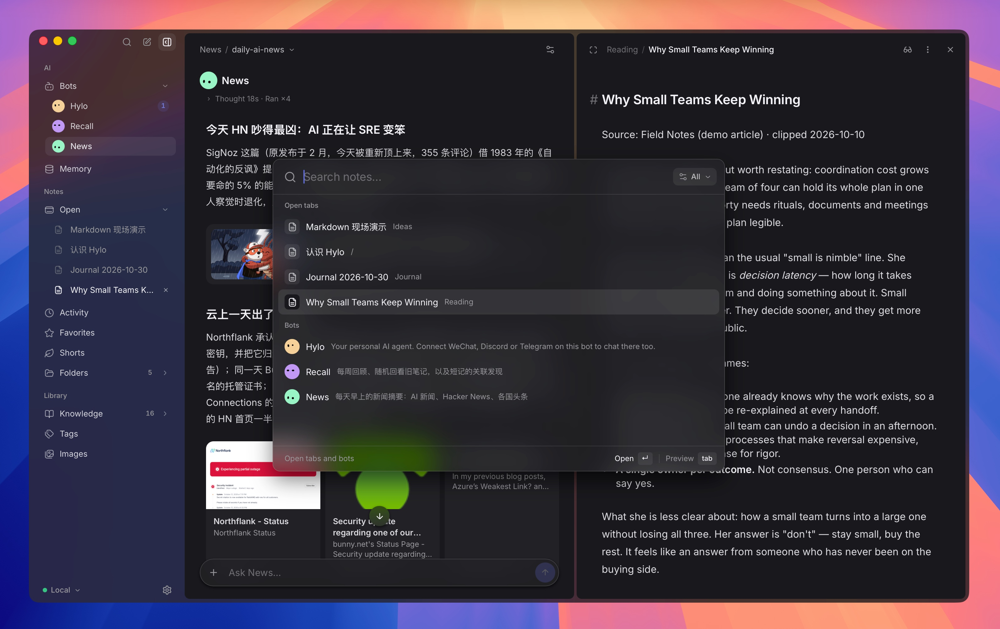

# Hylo

**Your notes. Your context. Your AI.**

Hylo 是一个自带 Personal AI 的笔记软件。你写笔记，AI 把笔记编译成关于你的上下文，你的 AI 再带着这些上下文为你做事。所有数据都在你自己的机器上。

[English](./README.md)



## Your notes：你的笔记

一个完整的笔记库，所有笔记文件都归你。

- **写和记**：所见即所得的 Markdown 编辑器，Shorts 接住随手的想法，即时搜索，浏览器扩展一键把网页存成 Markdown。
- **不锁定**：可以和 Obsidian 共用同一个 vault，也能用任何编辑器打开；哪天不用 Hylo 了，笔记原样带走。

## Your context：你的上下文

零散的笔记，AI 很难直接用上。Hylo 让 AI 把它们编译成结构化的上下文，真正派得上用场：

- **知识 Wiki**：笔记和剪藏被编译成 `/_knowledge/` 下互相链接的知识单元，汇成一张 LLM Wiki 地图。
- **个人记忆**：你是谁、想要什么、相信什么、身边有谁、眼下在忙什么、习惯怎么写。存在 `/_memory/`，随着你的书写持续更新。

个人上下文是你最私密的数据。在 Hylo 里，它是你自己 vault 里的 Markdown：看得见、改得了，不交给任何 AI 厂商保管。

## Your AI：你的 AI

一个懂你、只为你做事的个人 AI，不听命于任何平台。

- **懂你**：每次对话都带着你的记忆和知识开场，不用反复介绍自己。
- **为你做事**：笔记进来、时间一到，bot 就自己动起来：编译剪藏、更新记忆、把旧笔记带回你眼前。装上 skill 还能做更多，比如替你挑出值得看的新闻。在 App 里，或者在微信、Discord、Telegram 里都能找它。
- **不被厂商绑住**：Hylo 驱动的是你自己选的 agent CLI（**Claude Code、Codex、OpenCode、Cursor Agent、GitHub Copilot CLI、Pi**），想换随时换。Server 部署在你自己的机器或云主机上，合上笔记本也照常在线。

## 开始使用

1. **桌面 App**：去 [Releases](https://github.com/skoowoo/hylo/releases/latest) 下载 `.dmg`。如果 macOS 拦截，到 **系统设置 → 隐私与安全性 → 仍要打开**。App 会把 `hylo` CLI 装到 `~/.local/bin`，把它加进 `PATH`：

   ```sh
   export PATH="$HOME/.local/bin:$PATH"
   ```

2. **Onboarding** 会用你的 agent CLI 建好主 bot **Hylo**，剪藏自动编译、记忆每日更新都已配好。
3. **Clip 扩展**（可选）：同一页面下载 `hylo-clip-*.zip`，解压后在 `chrome://extensions/` 打开开发者模式并加载。
4. **全天在线**（可选）：在另一台主机上安装 Server，按[远程部署](./docs/remote-deployment.md)操作：

   ```sh
   curl -sL https://raw.githubusercontent.com/skoowoo/hylo/main/install-cli.sh | sh
   ```

### 用现有的 Obsidian vault

在 **Settings → Server → Config → Vault** 里选中 vault 目录并保存。Hylo 会自动初始化，在目录里加一个 `.hylo/` 文件夹并为笔记建好索引，vault 里的其他内容不动，Obsidian 照常使用。

## 使用前须知

- **目录保持扁平**：一层分类目录最好用。
- **文件名保持唯一**：Wikilink `[[名字]]` 按文件名引用，不按路径。
- **`_` 开头的目录归 Hylo**：`_knowledge/`、`_memory/`、`_shorts/` 等是系统目录，你自己的目录不要用 `_` 开头。
- **自备 agent**：先装好至少一个上面支持的 agent CLI，推荐 Pi。

## 文档

- [Bots](./docs/bots_zh.md)：触发器、Hylo bot、微信 / Discord / Telegram、自定义 prompt
- [上下文](./docs/context_zh.md)：知识 Wiki 和个人记忆是怎么生成的
- [Skills](./docs/skills_zh.md)：内置 skill，从 GitHub 添加更多
- [远程部署](./docs/remote-deployment.md)：在 HTTPS 后面 7×24 运行 Hylo

## 架构

Hylo Server 是一个独立的 Go 二进制，内嵌 SQLite 和全文索引。桌面 App、CLI、聊天渠道和 Clip 扩展都通过 HTTP 连接它，跑在本地还是远程主机上都一样。

```
 Desktop App   CLI   WeChat / Discord / Telegram   Clip
      └─────────┴──────────────┬──────────────────┘
                               ▼
                          Hylo Server
      ┌──────────────┬─────────┴────┬──────────────┐
  Markdown files   SQLite     Full-text index   Agent CLIs
```
