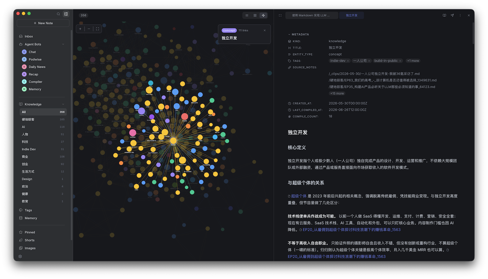

# Context

Hylo builds two kinds of context from your notes. Both are plain Markdown in your vault: you can read them, edit them, and every bot uses them.



## Knowledge wiki

Notes are compiled into structured knowledge units under `/_knowledge/`, linked into a wiki the agent can navigate.

The [Hylo bot](./bots.md#the-hylo-bot) compiles:

- **on request**: click **Compile** on an open note (`compile_requested`)
- **web clips**: new notes under `/Web Clips/` are compiled automatically (`note_created`)

To auto-compile another folder, edit the `note_created` trigger and add it to **Path Prefixes** (e.g. `/journal/`). To let another bot compile, give it the same two triggers.

Each run compiles the note with the `hylo-compile-note` skill, updates the knowledge index with `hylo-index-knowledge`, then polishes the new units with `humanizer`.

## Personal memory

Memory is kept in seven files under `/_memory/`: identity, preferences, goals, beliefs, people, current state, and voice (how you want your writing done). By default it reads your short notes (`/_shorts/`) and knowledge (`/_knowledge/`).

The Hylo bot updates it every day at 09:00. To scan more folders, edit that `scheduled` trigger's prompt:

```
Please update my personal memory from my recent notes. Also scan /journal/.
```

You can also ask any bot in chat, with a short introduction for the first run:

```
Please update my personal memory. I'm [name], currently working on [project], …
```

The first run scans the last 90 days; later runs scan the last 2 days. Memories that stop coming up fade out over time.
