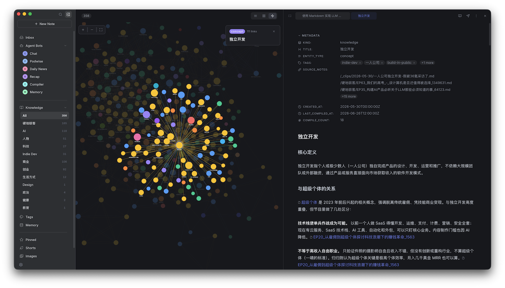

# 上下文

Hylo 从你的笔记里生成两种上下文。两者都是 vault 里的普通 Markdown：你可以看、可以改，每个 bot 都会用到。



## 知识 Wiki

笔记会被编译成 `/_knowledge/` 下的结构化知识单元，互相链接成一个 agent 能顺着走的 wiki。

[Hylo bot](./bots_zh.md#hylo-bot) 在两种情况下编译：

- **手动**：打开笔记后点 **Compile**（`compile_requested`）
- **剪藏**：`/Web Clips/` 下的新笔记自动编译（`note_created`）

想让别的目录也自动编译，编辑 `note_created` 触发器，在 **Path Prefixes** 里加上（如 `/journal/`）。想让别的 bot 来编译，给它加上同样两个触发器。

每次运行先用 `hylo-compile-note` 编译笔记，再用 `hylo-index-knowledge` 更新知识索引，最后用 `humanizer` 润色新生成的知识单元。

## 个人记忆

记忆存在 `/_memory/` 下的七个文件里：身份、偏好、目标、信念、人际关系、当前状态、文风（你希望文字怎么写）。默认读取速记（`/_shorts/`）和知识库（`/_knowledge/`）。

Hylo bot 每天 09:00 更新一次。想多扫几个目录，编辑这个 `scheduled` 触发器的 prompt：

```
请根据我最近的笔记更新个人记忆。另外请扫描 /journal/ 目录。
```

也可以在聊天里直接让任意 bot 更新，第一次最好附上简单的自我介绍：

```
请更新我的 memory。我是 XXX，目前在做 YYY 项目，…
```

首次运行扫描最近 90 天，之后每次只扫最近 2 天。长期不再出现的记忆会慢慢淡出。
