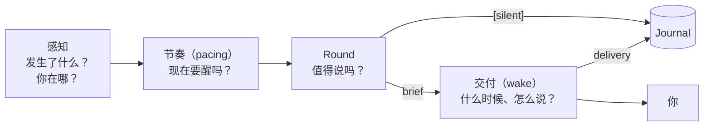
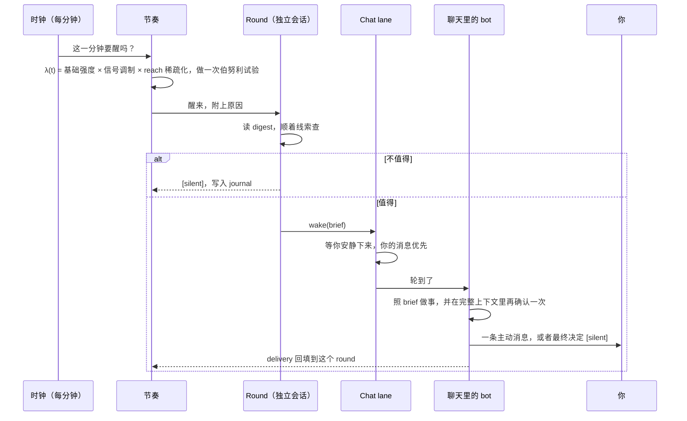

# 会主动开口的 Bot：Hylo Pulse 的设计与实现

大多数 AI 助手是被动的：你问，它答。Hylo 的主 bot 多了一种能力：它会**不定时自己醒来，在你的笔记库里看一圈**。它会看你刚写了什么、其他 bot 发现了什么、自己答应过的事有没有到期，再看看你此刻在不在电脑前，然后决定是保持沉默，还是来告诉你一件值得知道的事。

我们把这套机制叫做 **Pulse**，把每一次醒来巡视叫做一个 **round**。这篇文档讲 Pulse 的设计：我们想要什么样的"主动"，架构为什么这样拆分，节奏背后的数学模型，以及每个关键决定背后的考虑。

---

## 0. 术语

| 术语 | 含义 |
| --- | --- |
| **Pulse** | 主 bot 主动巡视的整套机制：决定何时醒、醒来看什么、要不要开口。 |
| **Round** | 一次巡视。在独立、只读的会话里进行，结局只有两种：`[silent]`，或者一份 brief。 |
| **Brief** | round 写给"聊天里的自己"的工作说明：要做什么或告诉用户什么，为什么是现在，依据是什么。它不是给用户的消息草稿。 |
| **Wake** | 把一项任务送进 bot 聊天的唤醒。trigger 和 Pulse 都通过 wake 进入聊天。 |
| **Trigger** | 规则唤醒：定时任务，或"有新笔记时"这类事件。它早于 Pulse 存在，与 Pulse 并行。 |
| **Chat lane** | 每个 bot 的聊天队列。同一时间只处理一件事，用户的消息永远优先于 wake。 |
| **`[silent]`** | 沉默标记。round 或 wake 以它结尾，表示看过了、不值得说。沉默的 wake 会从聊天记录里完全移除。 |
| **Agenda** | bot 自己的待办清单。每一项可以带一个 due（到期时间），到期就会触发一个 round。 |
| **Signal / boost** | 信号与加成。最近发生的事（新 short、改动的笔记、用户回来了……）对醒来概率的提升。 |
| **Lead** | 一类关注点：每分钟看一眼，给出加成、醒来的原因和 digest 里的一节。信号和 nudge 都是 lead。 |
| **Nudge** | 没有新事发生、但用户久没做某件 hylo 该帮他做的事（记录、回顾、旧的待办）时，bot 主动提起。有节制地提，不催促。 |
| **Reach** | 一条消息此刻会在哪里找到用户：电脑前、手机上、推送，还是只能等他回来。 |
| **Presence** | 桌面在场。桌面 app 报告的"用户在不在电脑前、前台是哪个 app"。 |
| **Settle point** | 上一个 round 和它引发的 wake 都结束的时刻。只有这之后发生的事才算"新的"。 |
| **Journal** | round 的记录：为什么醒、看到了什么、决定、brief、最终结局。 |
| **Delivery** | 一份 brief 的最终结局：已发出、沉默、失败、取消或放弃。 |
| **Active hours / budget / min gap** | 活跃时段、每日 round 预算、两个 round 之间的最短间隔。 |

---

## 1. 问题：主动为什么难

让 bot 主动开口，技术上很简单：定个时，让它跑一次，把结果发给用户就行。难的是让人愿意让它一直开着。

一个主动的 bot 很容易变成下面这些样子：

- **打扰**：在你专注的时候弹出来，说一件可以晚点再说的事；
- **噪声**：为了显得有用而开口，复述你刚做过的事，或者把同一件事说第二遍；
- **不透明**：在你不知道的时候改了你的笔记；
- **昂贵**：每一次"看一眼"都是一次完整的模型运行；
- **不可信**：答应提醒你，到时候却没有提醒。

只要出现一次，用户就会把它关掉。所以 Pulse 的核心问题不是"怎么让 bot 主动"，而是**怎么让主动这件事值得信任**。

---

## 2. 设计原则

下面每一条都对应上面的一种失败方式。

### 没有新东西就沉默，有就现在说

没什么新东西时，round 以 `[silent]` 结束。只要你**此刻知道会更好**，bot 就现在开口，不等更好的时机：

- 它答应过的事到期了；
- 你正在写的东西，能用上库里的一个事实或联系，或者和库里的内容有矛盾；
- 某个 bot 做出了你会想看的成果，但一直没人看；
- 你留下的一个线头，现在可以往前推一步。

不开口的理由同样明确：不为了表示"我还在"，不复述你做过的事，不重复说过的话。但"你正忙"不在其中：在电脑前，消息只是安静地等在聊天里，你什么时候看由你决定。

### 不定时

固定时间的提醒很快会被当作背景噪声。人的注意力有节奏，bot 醒来的时刻也应该跟着节奏变：你刚写了一条新想法，它更可能醒来；你连续几小时没动静，它就睡得更久。所以 round 的时刻是随机的，概率由 budget 和 signal 共同决定（见第 4 节）。

### 判断和行动分开

round 在**独立、只读的会话**里进行，只做一件事：决定值不值得说。真正要做的事（改一篇笔记、整理一段内容、写一条消息）由 brief 带进**聊天**，在那里完成，你能在聊天里看到它做的每一步。

这样分开，是因为两件事需要的条件不同。判断需要安静地看很多东西，不应该打扰你，也不应该留下痕迹；行动必须在你看得见的地方发生。

### 没有看不见的改动

round 按约定不写任何笔记。万一写了，这个 round 会被强制判为"必须开口"：聊天里那一轮不能 `[silent]`，必须告诉你改了什么、为什么。bot 可以犯错，但不能悄悄地犯错。

### 只承诺能兑现的事

bot 可以对你说"明天早上提醒你"，前提是有东西会在明天早上叫醒它。所以只有 Pulse 真的在运行时，bot 才知道自己可以做这类承诺。承诺记在 agenda 里，到期时一定会醒；那个 round 如果失败了，承诺不会丢，过一会儿再试。

### 感知你，但不评判你

为了挑对时机，bot 需要知道你在不在电脑前、在用哪个 app。它只用 presence 判断"现在适不适合开口"，除非你主动问起，它从不评论你怎么花时间。nudge 也一样：久没记录时，它递给你一个具体的问题，而不是告诉你"已经五天没写了"。采集的范围也压到最小：只有 app 名称，从不读取窗口标题或屏幕内容。

### 从小处开始

第一阶段只有**主 bot**有 Pulse 和 agenda。其他 bot 仍然只由 trigger 唤醒，比如"每天早上整理记忆"或者"有新笔记时编译知识"。Pulse 是和 trigger 并行的一条新路径，不改变已有的任何行为。

---

## 3. 架构总览

Pulse 分成四层，每层只回答一个问题：

| 层 | 问题 | 输入 | 输出 |
| --- | --- | --- | --- |
| **感知** | 发生了什么，你在哪 | 笔记的改动、你读了什么、你最后一次发消息的时间和来源、presence、到期的 agenda | 一组带时间戳的事件 |
| **节奏** | 现在要醒吗 | 事件、剩余 budget、离上个 round 多久 | 醒，或者继续睡 |
| **Round** | 值得说吗 | 一份快照（digest），加上一组往深处查的工具 | `[silent]`，或者一份 brief |
| **交付** | 什么时候、怎么说 | brief、chat lane 的状态、reach | 聊天里的一条消息，一个桌面通知或手机推送 |

每一层都可以单独调整，也可以单独观察。比如"bot 说得太多"可能是节奏层醒得太频繁，也可能是 round 的门槛太低，两者在 journal 里能清楚地区分开。

一次完整的过程是这样的：

---

## 4. 节奏：一个调制的随机点过程

### 4.1 问题的形式化

我们希望 round 的时刻满足四个要求：

1. **数量受控**：一个活跃日内不超过 budget $N$；
2. **时刻不可预测**：不能形成固定节律；
3. **跟随用户**：有事发生时更密，无事时更疏；
4. **看消息落在哪里**：不插进对话，离开电脑时少响手机。

把 round 的时刻看作时间轴上的一组随机点，这正是**点过程（point process）**要描述的对象。我们用一个**强度函数（intensity）** $\lambda(t)$ 描述"在时刻 $t$ 附近醒来的倾向"，再用若干硬约束把不合适的时刻排除掉。

实现上时间按分钟离散化：每分钟做一次**伯努利试验**，成功概率为

$$
p_t \;=\; \min\!\Big(1,\; \underbrace{\frac{k_t}{n_t}}_{\text{预算节奏}} \cdot \underbrace{\big(1 + b_t\big)}_{\text{信号调制}}\Big) \cdot \underbrace{r_t}_{\text{reach 稀疏化}}
$$

- $k_t$：本活跃日剩余的 round 数（budget 减去已经发生的）；
- $n_t$：本活跃日剩余的分钟数；
- $b_t$：信号加成（boost），$0 \le b_t \le 3$；
- $r_t$：reach 系数，$r_t \in \{1, 0.7, 0.5\}$。

每分钟的成功概率很小时，伯努利试验序列近似一个**非齐次泊松过程**，$p_t$ 就是每分钟的强度。下面逐项解释。

### 4.2 预算节奏：顺序抽样

先看没有任何信号（$b_t = 0$）、也没有其他约束的情况：每分钟以 $k_t / n_t$ 的概率醒来，醒一次 $k_t$ 就减一。

这正是**顺序抽样（selection sampling）**，即 Knuth 的 *Algorithm S*：从 $n$ 个元素中按顺序逐个考察，以"还需要选的个数 ÷ 还剩的个数"的概率选中当前元素。它有一个经典结论：

> 最终恰好选中 $k$ 个元素，并且所有 $\binom{n}{k}$ 种组合出现的概率相同。

放到 Pulse 里：**在理想情况下，一天的 round 恰好是从活跃分钟里均匀随机抽出的 $N$ 个时刻。** 数量是确定的，位置完全随机，也不需要预先排好时间表。

这个形式还带来一个重要性质：**自校正**。概率每分钟都按"还剩多少、还剩多久"重新计算，不依赖过去的计划：

- 上午因为信号醒得多，下午的 $k_t$ 变小，概率自动降低；
- 上午因为一直在聊天而被跳过，下午的 $k_t / n_t$ 变大，概率自动升高；
- 预算永远不会超支：$k_t = 0$ 时概率为零。

它本质上是一个反馈控制器，与广告投放里的 **budget pacing** 同一思路：只看剩余预算和剩余时间，就能把消耗均匀地摊到整个周期上。

### 4.3 信号调制：带指数核的 Cox 过程

再看 $(1 + b_t)$ 这一项。它让强度随外部事件起伏：

$$
b_t = \min\!\Big(3,\; \sum_{i} w_i \, e^{-(t - t_i)/\tau}\Big), \qquad \tau = 45\ \text{分钟}
$$

其中 $t_i$ 是第 $i$ 个事件的时刻，$w_i$ 是它的权重：

| 事件 | 权重 $w$ | 为什么 |
| --- | --- | --- |
| 你写了一条新的 short | 0.6 | 一条独立的新想法，最可能和别处有联系 |
| 一篇笔记被改动 | 0.5 | 你正在推进的东西 |
| 你读了一篇（没被改动的）笔记 | 0.2 | 说明你关心它，但不一定有新内容 |
| 你离开很久后回来了 | 1.5 | 刚回来是最适合告诉你积压事情的时刻；不衰减，持续 30 分钟 |

几点说明：

- **指数衰减核**：时间常数 $\tau = 45$ 分钟，对应**半衰期** $\tau \ln 2 \approx 31$ 分钟。半小时前写的 short，影响还剩一半左右。
- **计数去重**：同一篇笔记、同一条 short 只计一次（取最近一次），只看最近 3 小时，所以一阵密集的自动保存不会被重复计分。
- **饱和**：加成上限为 3，强度最多是基础值的 4 倍。这是一个简单的饱和函数，防止一阵密集活动把概率推到 1。
- **乘性调制**：信号乘在预算节奏上，而不是加在上面。所以信号只是**把预算往现在挪**，不会增加一天的总量；挪走的部分由 4.2 节的自校正从未来扣回。

强度本身由外部事件流驱动、又是随机的，所以这在数学上是一个**双随机泊松过程（Cox process）**；指数核的形状和 **Hawkes 过程**里常用的激发核相同。

区别在于：Hawkes 过程是**自激的**，自己的事件会推高自己的强度；而 Pulse 必须避免自激。bot 在聊天里改的一篇笔记，不应该让它下一分钟又醒一次。所以 Pulse 只计 **settle point 之后**的事件：settle point 是上一个 round 开始、结束，以及它引发的 wake 结束这三个时刻中最晚的一个。这样，由 bot 自己引起的事件被排除在激发源之外，过程保持为"只被用户驱动"。

另外，改动不区分是你写的，还是 bot 替你写的。你委托 bot 写的笔记、自动编译出来的知识，同样代表你的意图和关注点。只有 bot 在自己的 round 和 wake 期间产生的改动，才通过 settle point 被排除。

### 4.4 "你回来了"：基于间隔的会话切分

"回来"是权重最高的信号，判断方式本质上是**会话切分（sessionization）**：两次活动之间的空白超过某个阈值，就认为开始了一段新的会话。按可信度由高到低，只取第一个成立的来源：

1. **手机**：最近 30 分钟内从 Telegram、Discord 等连接的 app 给 bot 发过消息，说明手机在你手上；
2. **Presence**：离开电脑至少 1 小时后重新出现；
3. **没有 presence 时的近似**：把你读笔记、发消息的时间排序，相邻两次间隔 ≥ 4 小时的位置视为新会话的开始。

presence 的判断用了**两个不同的阈值**，形成一种滞回（hysteresis）：

- 5 分钟没有输入就算"离开"，判断很灵敏；
- 但要离开满 1 小时再出现，才算"回来"。

去倒杯水、开个短会这类短暂离开，只会把时间线切开，不会被当成"回来"，也就不会一次次触发高权重信号。

### 4.5 Reach：独立稀疏化

同一句话，在你坐在电脑前时是一条安静的消息，在你出门时是手机的一次震动。所以节奏层还要判断 **reach**：

| Reach | 条件 | 系数 $r$ | 消息的形式 |
| --- | --- | --- | --- |
| 电脑前 | presence 显示你在 | 1 | 聊天消息 + 桌面通知 |
| 手机在手 | 不在电脑前，但 30 分钟内用手机发过消息 | 1 | 推到手机，几句纯文本 |
| 推送 | 不在电脑前，bot 连着能主动发消息的 app | 0.7 | 推到手机，门槛更高 |
| 无法触达 | 不在电脑前，也推不到手机 | 0.5 | 等你回到电脑前才看到 |
| 未知 | 没有 presence，也没有手机迹象 | 1 | 聊天消息 |

乘以系数 $r \le 1$，在点过程里叫**独立稀疏化（independent thinning）**：每个候选点以概率 $r$ 保留。它不改变时刻的随机性，只按比例降低密度，这正是我们想要的"不在电脑前就少打扰"。

### 4.6 硬约束

概率之外，还有几条不讨价还价的规则。用点过程的语言说，它们是对可行时刻的截断：

| 约束 | 点过程中的含义 | 规则 |
| --- | --- | --- |
| Active hours | 支撑集限制 | 不在活跃时段内，强度为零；时段可以跨过午夜 |
| Min gap | **不应期（refractory period / dead time）** | 上一个 round 之后 20 分钟内，强度为零 |
| 互斥 | — | 同一时间最多一个 round |
| 聊天占用 | 外部门控 | chat lane 里有消息在处理或排队，或你最后一条消息不到 7 分钟，就不醒 |
| 到期的 agenda | 确定性点 | 不受 budget 和 min gap 限制，到点就醒 |

截断会让实际 round 数少于 budget：被截掉的分钟没有机会抽签。但因为 4.2 节的自校正，截断前后的剩余预算会被重新摊到之后的可行时刻上，不会出现"上午全被跳过，下午一次也补不回来"的情况。

### 4.7 可解释性

每一分钟的抽签都会留下记录：概率、加成、reach，以及加成由哪些信号构成，用一句人话表达，例如"2 篇笔记改动，你读了 1 篇；你离开 3 小时后回到了电脑前"。如果这一分钟根本没有抽签，也会写明被哪条硬约束挡住。

这句话同时作为醒来的原因交给 round。bot 知道自己为什么醒，也就知道先看哪里。

---

## 5. Round：值不值得说

### 5.1 快照加线索：digest

醒来后，round 拿到一份简短的 **digest**：

- **此刻**：几点了，上个 round 是多久以前，你最后一次给 bot 发消息是什么时候；
- **你在哪**：在用哪个 app、多久了，是不是刚回来，reach，今天大致的时间分配和最近两小时的时间线；
- **Agenda**：所有未完成的项，标出哪些已经到期；
- **自 settle point 以来**：新写的 short（带原文）、改动的笔记、你读过的笔记，最多回溯 24 小时；
- **可以提起的 nudge**：此刻允许提的每个 nudge，附上它看到了什么、该怎么提（第 8 节）；
- **聊天**：bot 和你最近的几句对话；
- **其他 bot**：每个 bot 一行，包括有几条你还没看的消息、最后一次活跃是什么时候；
- **它最近主动说过的话**：以及你有没有在 12 小时内回复；
- **最近几个 round**：当时的决定、brief 和 delivery。

digest 只是起点。真正的判断要靠 round **顺着线索往下查**：读那篇刚改动的笔记，在库里搜它关联或矛盾的内容，看看其他 bot 的聊天，查一下更早的阅读记录。

我们刻意不把所有信息都塞进 digest：

- 塞进去的信息越多，模型越倾向于"总得说点什么"；
- 线索式的快照让注意力花在真正活跃的地方；
- 新的感知能力可以做成新工具，不必让 digest 无限变长。

### 5.2 探索工具

除了读笔记、搜索、知识库这些常规能力，round 还有几个专门用来"往远处看"的工具：

| 工具 | 回答的问题 |
| --- | --- |
| Bot chat | 其他 bot 最近说了什么，哪些消息你还没看，它们是被什么唤醒的 |
| Activity | 谁（你，或者哪个 bot）什么时候读写了哪篇笔记；只计真正的阅读，不计列目录、搜索这类浏览 |
| Screen time | 你此刻在做什么，今天时间大致花在哪类事情上 |
| Rounds | 自己之前的 round 看过什么、做过什么决定、结局如何 |
| Agenda | 增加、查看、关闭 agenda 项 |

这些工具对所有 bot 开放，在命令行里也都有对应的命令。

### 5.3 有限的探索

一个 round 大约允许十五次工具调用，并且五分钟后强制结束。没什么可看的时候，快速看一眼、保持沉默就对了；线索真的值得追，也有足够的空间追到底。超时的 round 记为失败。

探索只在 vault 里：笔记、短记、知识库和 hylo 工具。即使知道路径，round 也不读 vault 外的目录、代码仓库或 git；你在电脑前做什么，只从 `screen_time` 得知。这是 prompt 约束：agent 以跳过权限的方式运行，cwd 不是权限边界，round 不另加 sandbox。

round 在**全新的会话**里进行：不保存消息，不接续之前的会话，不占用 chat lane，你在聊天里的消息不用等它；也不会在编辑器里当着你的面打字。round 可以用单独指定的模型，通常是一个更便宜的模型。

### 5.4 从反馈里学会克制

digest 会列出 bot 最近主动发出的消息，以及你有没有回复。round 的指令明确告诉它：**没被回复的消息越多，越要少说。**

这是一个负反馈回路：你不理它，它就自己安静下来。它作用在 round 的判断门槛上，与第 4 节的强度模型互补：一个控制多久醒一次，一个控制醒来后多大概率开口。

### 5.5 时机判断

round 考虑的是消息会落在哪里，而不是你忙不忙：

- **你在电脑前**：不管在哪个 app、是否在打字，消息都只是等在聊天里，有值得说的就现在说；
- **你不在电脑前**：消息会让手机震动，只说值得这一下的事，其余的等你回来。

agenda 的 due 只用于真正到时间才该做的事，不用来"等他空下来"。否则每次到点看到你还在忙就再挪，round 会陷入不断推迟的循环。

### 5.6 两种结局与判定

round 只能以两种方式之一结束：

1. **`[silent]`**：一句话说明看了什么、为什么不值得说，最后一行是沉默标记；
2. **brief**：要做什么或告诉你什么，为什么是现在，依据哪些笔记或消息。

判定规则：

| 结果 | 条件 |
| --- | --- |
| Silent | 以 `[silent]` 结束，且没有写任何笔记 |
| Failed | 运行出错或超时，且没有写任何笔记 |
| Speak | 其他所有情况，**包括写了笔记的任何一个 round** |

最后一条保证了"没有看不见的改动"：哪怕 round 失败了，只要它写过笔记，你都会知道，而且这些写入会被记在 bot 名下。

---

## 6. 交付：wake 与 chat lane

### 6.1 为什么还要再过一遍聊天

round 决定 speak 之后，并不直接给你发消息，而是把 brief 包成一个 **wake**，送进 bot 的聊天。多这一步有三个原因：

1. **round 看不到聊天，聊天能看到。** 也许在 round 进行的这五分钟里，你已经在聊天里问过同一件事。聊天里的 bot 看到完整对话后，可以判断已经不必说，回 `[silent]`。
2. **聊天是唯一公开的地方。** 所有修改、所有消息都发生在你能看到、能回溯、能追问的地方。
3. **一个 bot 只有一个声音。** 无论是你问它、trigger 唤醒它，还是 Pulse 唤醒它，说话的都是同一个聊天里的同一个 bot，记忆和语气一致。

### 6.2 Chat lane 的调度规则

每个 bot 的聊天是一条 **chat lane**：同一时间只处理一件事。调度规则是一个带优先级的队列：

- **用户优先**：你的消息永远排在 wake 前面；
- **安静窗口**：wake 要等你安静 7 分钟才开始，不在你两条消息之间插话；
- **间隔**：两个 wake 之间至少隔一分钟，积压的消息不会连珠炮似地一次发出；
- **背压**：一个 bot 最多积压 5 个 wake，再多就直接放弃；
- **去重**：trigger 的 wake 可以带去重键（例如同一篇笔记的重复事件只保留一个）。Pulse 的 brief 不去重，每份都是独立的消息。

节奏层判断"聊天是否空闲"用的也是同一个安静窗口。所以 round 本身也不会在你对话的间隙里开始。

### 6.3 说成什么样

送进聊天的指令会根据情况调整：

- 消息会被你当作 bot 主动发来的，所以直接说重点，结尾不加"需要我帮你……吗"这类提议；
- 如果 round 写过笔记，必须说明改了什么、为什么，不允许 `[silent]`；
- 如果 reach 是手机，只写几句纯文本，不用格式。

最终的消息出现在聊天里，标注为 "On its own"，同时作为桌面通知弹出，并推送到连接的手机 app。如果聊天里的 bot 最后回了 `[silent]`，这次 wake 会从聊天记录里完全消失，不留空消息，也不发通知。

### 6.4 闭环：delivery

每一份 brief 最后都会有一个明确的 **delivery**，记回到产生它的 round 上：

| Delivery | 含义 |
| --- | --- |
| Sent | 你收到了这条消息 |
| Silent | 聊天里的 bot 判断已经不必说 |
| Failed | 聊天那一轮出错，或者 bot 在排队期间被停用 |
| Canceled | 服务在它排队时停止了 |
| Dropped | 排队已满，没能进入聊天 |

这个闭环有两个用处：下一个 round 能看到自己之前的 brief 结局如何；你在观察页上也能看到每个 round 从头到尾的经过。delivery 的时刻同时决定了 settle point（第 4.3 节）。

为了让闭环可靠，系统在结构上保证了三件事：

- **恰好一次结束**：每个 wake 无论在哪个阶段终止（排队时取消、轮到时 bot 已停用、在聊天里跑完），都恰好产生一次结束事件；
- **按标识关联**：每个 wake 携带它所属 round 的唯一标识，结局按标识回填，不会张冠李戴；
- **不互相覆盖**：brief 不参与去重，不会被另一份 brief 顶掉。

---

## 7. Agenda：承诺与到期

agenda 是 bot 自己的待办清单。每一项是一句话，加上可选的 due。bot 用它做两件事：

- **兑现承诺**：你说"明天早上九点提醒我"，或者它自己说"我晚点再看看"，就记下来，设好 due；
- **安排时机**：round 发现一件值得说、但你现在正专注的事，就放进 agenda，设一个更合适的时间。

### 7.1 到期即醒

到期的 agenda 项是 Pulse 里唯一的**确定性点**：它不受 budget 和 min gap 限制，只要在活跃时段内、没有 round 在跑、聊天空闲，就立刻开始一个 round，醒来的原因里写明是哪几项到期了。

### 7.2 至少一次，而非至多一次

一个 agenda 项只应该叫醒 bot 一次，但"这一次"是在 **round 成功完成之后**才算数：

- round 正常结束（无论 silent 还是 speak）：这一项标记为已触发，不会再因它醒来；
- round 失败（超时、模型不可用）：这一项保持未触发，进入 10 分钟的冷却后再试。

在分布式系统的术语里，这是在"至多一次"和"至少一次"之间选了后者。对承诺来说，偶尔多看一眼的代价，远小于漏掉一次提醒。冷却则是一个简单的**退避**，避免故障时每分钟都重试。

### 7.3 只在能兑现时承诺

只有 Pulse 真的在运行时，bot 在平时的聊天里才会被告知"你可以记 agenda，到时会叫醒你"。Pulse 关闭，或者因为配置错误没能启动时，bot 不知道这项能力，也就不会做出它兑现不了的承诺。

### 7.4 访问控制

agenda 只属于主 bot。系统会识别每一次操作来自谁：

| 来源 | 结果 |
| --- | --- |
| 你自己（命令行或页面） | 可以查看和修改 |
| 主 bot 正在进行的一次运行 | 可以修改 |
| 其他 bot | 拒绝 |
| 一次已经结束的运行 | 拒绝 |

为此，**每一次 bot 运行都携带自己的运行标识**。无论 bot 是通过工具接口操作，还是在终端里执行命令，系统都能分辨是谁、是不是还在运行，不会出现某个 bot 冒充主 bot，或者已经结束的运行继续操作的情况。

---

## 8. Lead 与 Nudge：可扩展的关注点

### 8.1 Lead：一个统一的接口

第 4 节的信号只回答"发生了什么"。但一个笔记库的助手还要注意"该发生的事很久没发生"：你很久没记录了，很久没回头读过了，一个待办在笔记里放了一个月。这些事不会产生任何事件，所以信号看不见它们。

为了让新的关注点容易加，Pulse 把所有关注点统一成 **lead**。一个 lead 只有一个函数：看一眼此刻，返回一个 finding：

| 字段 | 用途 |
| --- | --- |
| `pull` | 加到 boost 上，影响这一分钟醒来的概率 |
| `because` | 一句话，拼进"你为什么醒"，也显示在观察页上 |
| `lines` | digest 里属于这个 lead 的一节 |
| `due` / `items` / `done` | 只有 nudge 用：现在值不值得提、这次提起覆盖了哪些东西、用户上一次做这件事是什么时候 |

lead 可以声明 `every`：一次查看的结果保留多久。新 short、读过的笔记这类信号每分钟都看；习惯节奏要查 30 天的历史，每 15 分钟看一次就够；待办要扫描笔记，每小时一次。

第 4 节的四种信号（short、笔记改动、阅读、回来）现在就是四个 lead，行为和以前一样。加一个新关注点，只需要写一个 look 函数，放进 `leads` 列表；如果它是 nudge，再写一段怎么提的说明（`prompt/text/proactive/nudge_<name>.md`）。节奏、digest、journal、观察页都不用改。

### 8.2 Nudge：bot 主动提起的事

nudge 是一种特殊的 lead：没有新事发生，也值得说一句。现在有三个：

| Nudge | 什么时候算"该提了" | bot 怎么提 |
| --- | --- | --- |
| **writing** | 你在场的日子里，久没写东西（包括让 bot 替你写） | 从你最近在做的事里找一个具体的线头，问一个一两句话就能回答的问题；你的回答记成一条 short |
| **reading** | 你在场的日子里，久没读过笔记（包括让 bot 替你读） | 用 `sample` 抽几篇旧内容，挑一两篇和你现在相关的，说清楚为什么值得再看，最后问一个问题 |
| **todos** | 有未完成的待办，所在笔记 14 天到 180 天没动过 | 先读上下文，挑一两个最值得问的：还要做吗？可以帮你勾掉、删掉、排进 agenda，或者帮你推进下一步 |

bot 自己主动写的东西（nightly memory、round 和 wake 里的改动、`/_bots`、`/_memory`）不算"你在记录"。

### 8.3 用你自己的节奏判断"久"

"久"不是固定天数，而是相对于你自己的节奏：

- 只数**你在场的日子**：那天在电脑前，或者在 hylo 里做过任何事。出差、休假的日子不算，离开不是懈怠。
- 看最近 30 天，算出两次之间间隔的中位数 $m$（以在场天数计）。当前间隔达到 $\max(\text{下限}, 2m)$ 才算久。下限：writing 2 天，reading 4 天。
- 今天不计入间隔：早上还没写，不代表今天不写。
- 记录开始之前没有数据，不算懈怠。

### 8.4 不唠叨：节制规则

每个 nudge 都有自己的节制，规则是通用的，记录在 journal 里（`pulse_runs.nudged`）：

- 你做了这件事（写了、读了），节制从头开始；
- 提过一次后，等 3 天才能再提；之后你每放过一次（还是没做），等待时间翻倍；提到第三次就停下来，直到这些记录在 30 天后过期；
- 所有 nudge 加起来，一天最多提一次；
- 已经提过的待办，90 天内不再提；
- 你可以在 `proactive.mute` 里关掉任意一个。

一个 nudge 满足条件时，它给 boost 加 0.2，并出现在 digest 的"Nudges you could raise"一节里，附上该怎么提。是否开口、什么时候开口仍由 round 判断：现在不是好时机就不提，它之后还会出现。round 如果决定提，在 brief 末尾写一行 `[nudged: writing]`，一次只提一个。Pulse 把这一行从 brief 里去掉，记下这次提起和它覆盖的条目，并让聊天里的那一轮用一个容易回答的问题结尾（普通的主动消息不允许以问题结尾）。

只有真正送到你面前的提起才算数：delivery 是 sent，或者还在路上。round 决定提、但聊天那一轮最后选择沉默的，不算。

---

## 9. Presence：感知你在不在

### 9.1 采集什么

桌面 app 每 30 秒报告一次：

- 前台 app 的名称；
- 距离最后一次键盘或鼠标操作过了多久；
- 屏幕是否锁定。

就这些。不读窗口标题，不截屏，不记录你在 app 里做了什么。

### 9.2 从样本到状态

| 状态 | 判定 |
| --- | --- |
| 在 | 未锁屏，5 分钟内有输入，且有前台 app |
| 离开 | 锁屏、5 分钟没有输入，或 90 秒没有收到报告（app 关了，或电脑睡眠） |
| 回来了 | 离开至少 1 小时后重新出现（见 4.4 节的滞回） |
| 未知 | 超过 12 小时没有任何报告：不再说"你离开了"，而是承认不知道 |

连续的样本合并成**会话段**：同一个 app 连续在前台、中间断开不超过 90 秒，就算一段。汇总时按 app 计时，不做分类：模型认得 app 名，"Xcode 2h"比"工作 2h"说得更多。

服务重启后，"最后一次在场"的时刻从历史里恢复，所以 bot 仍然知道你离开了多久。

### 9.3 隐私边界

这部分数据最敏感，所以边界划得最严：

| 约束 | 做法 |
| --- | --- |
| 最小采集 | 只有 app 名称，从不读窗口标题 |
| 用途受限 | 只用来判断时机和理解上下文；除非你问起，bot 不评论你的习惯 |
| 两个开关 | 只有 Pulse 和 presence **都**开启时才保存；Pulse 关闭时，即使 presence 开关是开的也不保存 |
| 关闭即停止 | 服务端不保存时会明确告诉桌面 app，桌面 app 随之把上报频率降到每 15 分钟一次 |
| 有限保留 | 30 天后自动删除 |
| 随时清除 | 一键清除全部历史，连 bot 对你"何时离开、何时回来"的判断也一起清掉 |

---

## 10. 可靠性：靠结构保证，而不是靠补丁

主动系统的很多问题只在边界情况出现：重启、超时、并发、配置写错。我们尽量让这些问题**在结构上不可能发生**，而不是出现之后再修补。

| 风险 | 结构上的保证 |
| --- | --- |
| bot 被自己的改动叫醒，陷入循环 | 激发源只计 settle point 之后的事件，过程不会自激 |
| 承诺因为一次失败被永久跳过 | agenda 按"至少一次"语义：只有 round 成功完成才算触发 |
| brief 的结局下落不明 | 每个 wake 恰好结束一次，结局按 round 标识回填 |
| 一份 brief 被另一份顶掉 | brief 不参与去重，各自独立排队 |
| 重启后忘了最近发生的事 | 最近 24 小时的笔记改动持久化在本地文件里，重启时读回 |
| 重启后不知道你离开了多久 | 最后一次在场的时刻从历史中恢复 |
| 某个 bot 冒充主 bot | 每次运行都携带运行标识；已结束的运行一律拒绝 |
| bot 做出无法兑现的承诺 | 只有 Pulse 真正在运行时，bot 才被告知可以承诺 |
| 配置写错导致静默失效 | 开启 Pulse 但 active hours 为空，启动前的校验就会报错 |
| 清除历史后仍有残留判断 | 清除会同时重置内存里的 presence 状态，并且与新的上报互斥 |
| 预算超支 | $k_t = 0$ 时强度为零，由公式本身保证 |

最近的笔记改动刻意没有放进数据库，而是存成一个小文件：它只需要撑过一次重启，内容不超过一天，丢失的代价也只是某个 round 的 digest 不完整。

---

## 11. 可观察：你能看到它在想什么

主动系统如果不透明，就很难建立信任，也没法调优。Pulse 提供了一个观察页：

- **当前节奏**：醒着还是睡着，今天用了几个 round、还剩几个，最近一分钟的 $p_t$、boost、reach 和信号描述；如果这一分钟没有抽签，写明被哪条约束挡住（睡眠时段、聊天正忙、不应期内、agenda 冷却中……）；
- **Agenda**：每一项和它的 due，以及是否已经触发过；
- **Journal**：每个 round 为什么醒、看到了什么、决定 silent 还是 speak、brief 的内容、delivery，以及它是否越界写过笔记。

页面上还可以手动触发一个 round，或者清除 presence 历史。

bot 自己也能读 journal。round 会参考之前几个 round 的决定，避免重复看同一件事、重复说同一句话。

---

## 12. 成本

每个 round 都是一次完整的模型运行，speak 的 round 还要在聊天里再跑一次。控制成本靠以下几点：

- **budget** 是硬上限，由强度公式本身保证不超支；
- **没有新东西就沉默**，这样的 round 很快就结束；
- **round 可以用更便宜的模型**，给你的消息仍由 bot 平时的模型来写：判断用小模型，表达用大模型；
- **工具调用和时长都有上限**；
- **你在聊天时不醒**，不和你的对话抢资源。

"round 一次、聊天再一次"的双重运行是有意的选择：它换来了"在完整上下文里再确认一次"和"所有行动发生在聊天里"。在真正观察到成本问题之前，我们不急着优化掉它。

---

## 13. Pulse 与 Trigger

| | Trigger | Pulse |
| --- | --- | --- |
| 适用于 | 任何 bot | 目前只有主 bot |
| 何时发生 | 确定的事件或时间 | 随机点过程；到期的 agenda 是确定性点 |
| 做什么 | 执行规则里写好的任务 | 先由 round 判断值不值得，再决定做什么 |
| 怎么进入聊天 | 直接发 wake | round 决定 speak 后才发 wake |
| 去重 | 可以按事件去重 | 不去重，按 round 标识跟踪 |

两者共用同一套交付机制：同一条 chat lane、同样的安静窗口、同样的 `[silent]` 约定、同样的通知和推送。对你来说，bot 无论因为什么开口，体验都是一致的。

---

## 14. 取舍与下一步

几个有意为之的取舍：

- **宁可少说，不要多说。** 沉默是默认值，没人回复就更安静，你离开电脑时门槛更高。
- **宁可多跑一次，不要在看不见的地方行动。** 判断和行动分离，代价是一次额外的模型运行。
- **宁可多看一眼，不要漏掉承诺。** agenda 选择"至少一次"。
- **宁可少知道一点，也不越过隐私边界。** 只有 app 名称，只用于时机。

还没做、或者刻意推迟的：

- **其他 bot 的 Pulse**：先在主 bot 上验证这套节奏和判断；
- **"等我回到电脑前再告诉我"**：把消息延迟到你回来再发，用户决定以后再做；
- **多台电脑**：目前同一服务只有一份 presence 状态，多台 Mac 同时上报会互相干扰；
- **macOS 以外的平台**：其他平台暂不上报 presence，reach 一律为"未知"；
- **习惯回顾**：未来可以让 bot 定期回顾你的时间分配，但必须由你主动开启，不会默认开启；
- **更多 nudge**：比如其他 bot 的消息长期没看。按第 8 节的接口加，不需要改节奏和 round。

---

## 附录：配置

| 选项 | 默认 | 说明 |
| --- | --- | --- |
| Pulse 开关 | 开启 | 总开关；关闭时既不巡视，也不保存 presence |
| Budget（每日 round 数） | 24 | 一个活跃日内最多的 round 数；大多数以 `[silent]` 结束 |
| Active hours | 08:00–24:00 | 本地时间；结束时间可以跨过午夜 |
| Min gap | 20 分钟 | 不应期；到期的 agenda 不受限制 |
| Round 模型 | 与 bot 相同 | 可以单独为 round 指定一个更便宜的模型 |
| Presence | 开启 | 只有 Pulse 也开启时才生效；只记录 app 名称，保留 30 天 |
| Muted nudges | 无 | bot 不会主动提起的 nudge：`writing`、`reading`、`todos` |

配置保存在 vault 里，修改后重启服务生效。

## 附录：默认参数一览

| 参数 | 值 |
| --- | --- |
| 抽签粒度 | 每分钟一次 |
| 信号时间常数 $\tau$ / 半衰期 | 45 分钟 / 约 31 分钟 |
| 信号回看窗口 | 3 小时 |
| 加成上限 | 3（强度最多 ×4） |
| 权重：short / 笔记改动 / 阅读 / 回来 | 0.6 / 0.5 / 0.2 / 1.5 |
| "回来"信号有效期 | 30 分钟 |
| 无 presence 时的会话切分阈值 | 4 小时 |
| Presence：离开 / 回来 / 未知 | 5 分钟无输入 / 离开 ≥ 1 小时 / 12 小时无报告 |
| Reach 系数：推送 / 无法触达 | 0.7 / 0.5 |
| 手机在手的判断窗口 | 30 分钟 |
| 安静窗口 / wake 间隔 / 积压上限 | 7 分钟 / 1 分钟 / 5 个 |
| Round：工具调用 / 时长 | 约 15 次 / 5 分钟 |
| Agenda 失败冷却 | 10 分钟 |
| Digest 回看上限 | 24 小时 |
| "是否回复"的判断窗口 | 12 小时 |
| Nudge 加成 / 每日上限 | 0.2 / 1 次 |
| Nudge 节奏窗口 / "久"的阈值 | 30 天 / max(下限, 2 × 中位间隔)，下限 writing 2、reading 4 个在场日 |
| Nudge 再提间隔 / 停止 | 3 天，之后每多提一次翻倍 / 自上次做了这件事以来已提 3 次 |
| 待办：算"久没动" / 不再提 / 提过后冷却 | 14 天 / 180 天 / 90 天 |
