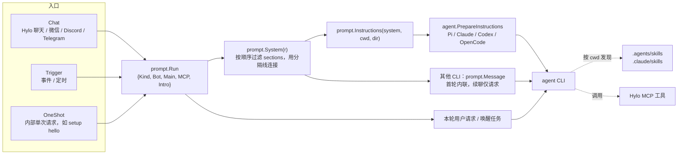
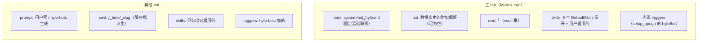
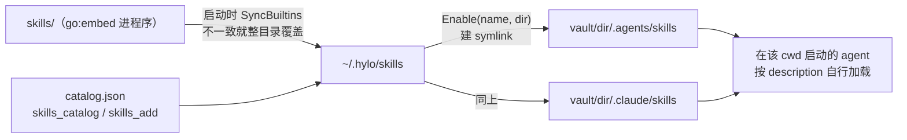
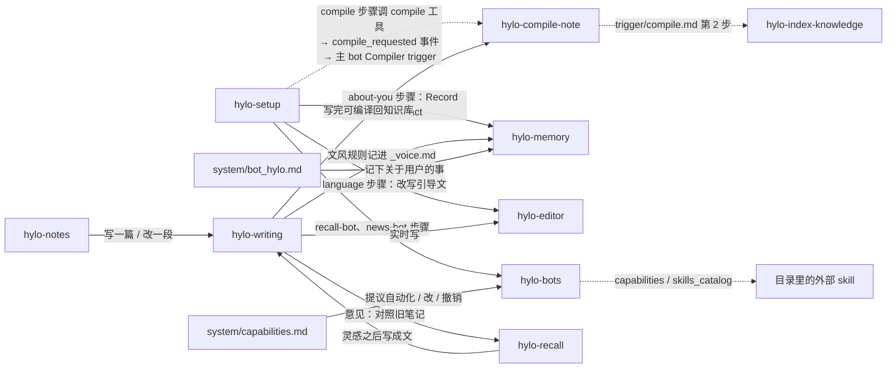
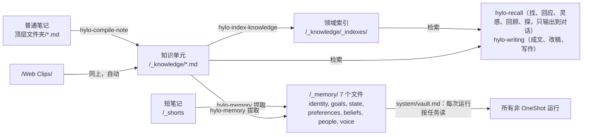
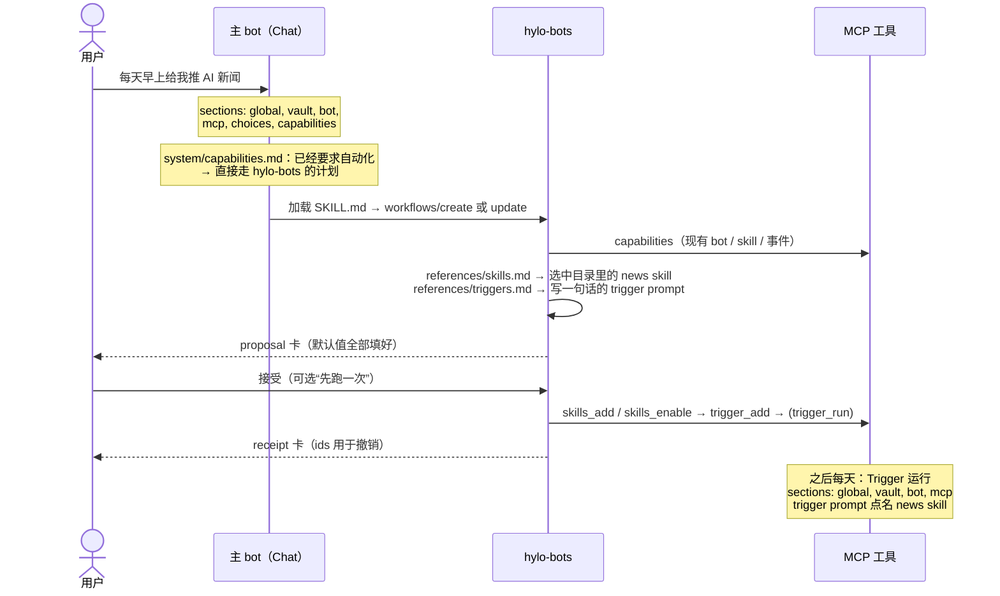

# Prompt + Skills 架构

Hylo 交给 agent 的指令分三层，各管一件事：

| 层 | 何时进入上下文 | 负责 | 源码 |
| --- | --- | --- | --- |
| **System prompt** | 每轮按条件拼装；原生追加给支持的 CLI，其他 CLI 随首轮发送 | 身份、vault 约定、该把请求交给谁 | `internal/prompt/` |
| **Skill** | agent 按 description 匹配到某项工作时才加载 | 这项工作怎么做 | `skills/`（内置，嵌进程序），`~/.hylo/skills`（运行时） |
| **MCP 工具** | 一直在工具列表里 | 真正读写 vault、管理 bot 和 skill | `internal/mcp/`（CLI 一一对应，见 `internal/cli/`） |

判断一段指令放哪一层：**每次运行都需要的放 prompt，做某件事才需要的放 skill，参数怎么填交给工具 schema。**

---

## 1. 一次运行怎么拼出指令



`executeChat`（`internal/server/handler/agent_api.go`）收集 `Run`：

- `Bot`：数据库中的指令；主 bot 用作附加偏好，其他 bot 用作岗位说明。调用方只能覆盖这一层。
- `Main`：是不是主 bot；决定是否注入产品维护的主 bot 基础职责。
- `MCP`：这个 agent 是否注入了 Hylo MCP。
- `Kind`：用户消息是 Chat；独立巡查是 Round；trigger 或 Pulse 主动交付是 Wake；内部单次请求是 OneShot。
- `Intro`：onboarding 后的第一次聊天。
- `global` 这一层固定是 `text/system/global.md`，没有配置项。

Pi、Claude Code、Codex 和 OpenCode 将常驻指令与本轮请求分开。`prompt.Instructions` 生成 sections 和工作目录说明，`agent.PrepareInstructions` 负责原生注入：

| CLI | 注入方式 | 生命周期 |
| --- | --- | --- |
| Pi | `--append-system-prompt <file>` | 每轮启动时追加，保留默认 prompt |
| Claude Code | `--append-system-prompt-file <file> --system-prompt-snapshot off` | 续聊重新生成 system prompt |
| Codex | `-c developer_instructions=...` | 用 `app-server` 的 `config/read` 读取有效配置，将已有 developer 指令与 Hylo 指令合并；不替换模型基础指令 |
| OpenCode | `OPENCODE_CONFIG_CONTENT.instructions` 中追加文件路径 | 与已有 instructions、MCP 和其他配置合并 |

文件按运行创建，目录权限为 `0700`、文件为 `0600`，子进程退出后清理，不改用户的指令文件。Codex 配置读取最多等待 10 秒，不启动模型请求；让 Codex 自己解析配置层和项目可信状态。注入失败会明确结束该轮，避免无指令执行。Codex 的指令参数在启动日志里脱敏。

Pi 的显式 `--append-system-prompt` 会替代 `APPEND_SYSTEM.md` 的自动发现，因此当前由 Hylo 接管 append 层，不自动合并项目或全局的 `APPEND_SYSTEM.md`；Pi 默认 system prompt、独立的 `SYSTEM.md` 选择、上下文文件和 skills 加载仍由 Pi 处理。此方案依赖每轮启动 CLI；长运行进程不能仅靠修改文件更新指令。

RPC / stdin 只发送本轮请求，包括渠道说明和 trigger 的唤醒信息。每轮重新计算 sections，因此 bot、apps 和 intro 等配置变化可在续聊中更新；不需要重发历史消息。已有会话中旧的首条内联指令仍在历史里，迁移不清空会话。

Cursor 和 Copilot 继续使用 `prompt.Message`，其首条消息仍为：

```
# Instructions

<system prompt>

---

Your working directory: <cwd> (the vault root | vault path /_bots/_xxx)

# User request

<用户消息，或 trigger 唤醒时的 WakeRequest（text/trigger/wake.md：谁唤醒的、回复会作为 bot 主动发的消息、可回 [silent]，再加 trigger prompt）>
```

这两个 CLI 的 **续聊（resume）只发用户消息**；修改 section 文本后，要新开会话才能验证。

---

## 2. System prompt 的 sections

定义在 `internal/prompt/sections.go`。全局约定、主 bot 基础职责、用户配置和本轮任务分别管理，避免用一段可编辑人格承担全部产品行为。

| 顺序 | Section | 负责 | 生效条件 |
| --- | --- | --- | --- |
| 1 | `global` | 共用表达、事实与任务边界，不指定 bot 名字和岗位 | 非 OneShot |
| 2 | `vault` | 知识库入口、归属、wiki 链接、共享 `/_memory/` 位置、卡片适用条件 | 非 OneShot |
| 3 | `main` | `system/bot_hylo.md`，主 bot 的学习伙伴定位和记录、记忆职责 | `Main && Kind != OneShot` |
| 4 | `bot` | 主 bot 的附加偏好，或其他 bot 的岗位指令 | 有非空配置；主 bot 的已知默认副本不重复注入 |
| 5 | `mcp` | Hylo MCP 工具发现与局部读取 | MCP 可用且非 OneShot |
| 6 | `choices` | 选项卡格式；是否提问由当前任务决定 | Chat 或 Wake |
| 7 | `embed` | 链接卡格式 | Chat 或 Wake |
| 8 | `capabilities` | 主 bot 的请求处理与自动化提案 | Chat 或 Wake，且 Main、MCP、非 Intro |
| 9 | `agenda` | 已请求或接受的后续事项 | Main、MCP、主动巡查开启，且非 OneShot |
| 10 | `apps` | 当前 bot 的已连接 app 能力及入口 | 非 OneShot；MCP app 要求 MCP，skill app 不要求 |
| 11 | `intro` | 首次引导任务 | Chat 且有 Intro |

`main` 由 `Run.Main` 决定，不受 `Run.Bot` 是否为空、是否被调用方覆盖影响。主 bot 的用户指令明确作为基础职责和本轮范围内的附加偏好。其他 bot 不接收主 bot 的身份、保存路由和自动化职责。

`apps` 只说明可访问的能力，不授予新任务。自主探索的范围和目的由 Pulse 本轮任务说明；专用 bot 按自己的岗位与任务使用 app。

Pulse 区分公开内容与用户账户数据：公开内容用于多元发现和推荐；账户数据既支持有意义的更新提醒，也支持订阅、收藏、未读内容的整体概览。概览呈现规模、主题分布和少量代表内容，即使没有新增也可能有价值；数量不是催促完成的理由。已推荐、平台标记已读和实际消费是不同状态，不能用最近几天或部分分页的结果冒充全量统计。入口、探索方法和消息时机仍由 agent 自主选择，不设置固定轮询或发送频率。

### 各类运行实际拿到哪些 sections

下表假定 MCP 可用；agenda 和 apps 按实际配置注入。

| 运行 | global / vault | main | bot | mcp | choices / embed | capabilities | agenda | apps | intro |
| --- | --- | --- | --- | --- | --- | --- | --- | --- | --- |
| 主 bot 聊天 | 是 | 是 | 附加偏好 | 是 | 是 | 是 | 按配置 | 按配置 | 否 |
| 其他 bot 聊天 | 是 | 否 | 岗位 | 是 | 是 | 否 | 否 | 按配置 | 否 |
| 主 bot 首聊 | 是 | 是 | 附加偏好 | 是 | 是 | 否 | 按配置 | 按配置 | 是 |
| 主 bot Wake | 是 | 是 | 附加偏好 | 是 | 是 | 是 | 按配置 | 按配置 | 否 |
| 其他 bot Wake | 是 | 否 | 岗位 | 是 | 是 | 否 | 否 | 按配置 | 否 |
| 主 bot Round | 是 | 是 | 附加偏好 | 是 | 否 | 否 | 按配置 | 按配置 | 否 |
| OneShot | 否 | 否 | 显式提供时 | 否 | 否 | 否 | 否 | 否 | 否 |

Round 在独立会话探索，输出沉默或候选简报；Pulse Wake 在共享聊天内复核并交付。普通 trigger 使用 `trigger/wake.md` 包装本轮任务。capabilities 即使出现在 Wake 中，也明确只对用户发起的请求生效，不能将后台发现或未回答的建议当作新授权。

卡片定义不强制当前轮使用卡片。任务要求纯文本、手机通知或微信 / Discord / Telegram 渠道时，用普通文字与链接；普通 trigger 不允许结尾提问时，choices 格式不构成提问理由。

---

## 3. Bot 层



主 bot 的固定职责每轮从代码注入，新建主 bot 的 `system_prompt` 留空。设置中此字段显示为 Additional instructions；其他 bot 仍显示 System prompt。

启动时，`prompt.SupersededMain` 配合 `ReplaceMainPrompt` 清空匹配已知默认文本的主 bot 副本，只忽略首尾空白，不改用户自定义内容。组装时也识别这些副本，避免迁移尚未完成时重复注入。普通 bot 不参与该迁移。 历史主 bot 文本保存在 `text/legacy/`，代码只保留迁移映射，不将历史文本注入当前指令。

主 bot 的内置 triggers：每条 trigger prompt 是该轮已配置的任务，不代表用户此时发起了新请求。

微信、Discord、Telegram 不是 trigger。每个 bot 在自己的 Channels 里接一个联系人，消息进入该 bot 当前的 chat，和桌面是同一场对话。微信和 Telegram 的回复在发出时转成纯文本。

| Trigger | 事件 | Prompt | 走哪个 skill |
| --- | --- | --- | --- |
| Compiler | `compile_requested` | `trigger/compile.md` | 点名 hylo-compile-note → hylo-index-knowledge → humanizer（有就用） |
| Compiler | `note_created`，限 `/Web Clips/` | 同上 | 同上 |
| Memory | `scheduled`，daily 01:05 | `trigger/memory.md` | 不点名，靠 description 匹配到 hylo-memory |

回顾不在主 bot 上：周回顾和随机回顾是定时消费，不是对话，交给独立的 Recall bot，由 hylo-setup 的 recall-bot 步骤创建（`/_bots/_recall`，启用内置 hylo-recall），两条 trigger 由用户多选。trigger prompt 就是 `trigger/recall_weekly.md` 和 `trigger/recall_random.md`，步骤文件逐字引用，`TestRecallBotStepQuotesTriggerPrompts` 防止两边走样。创建短记不再自动回顾。

| Trigger | 事件 | Prompt | 走哪个 skill |
| --- | --- | --- | --- |
| Weekly review | `scheduled`，weekly mon 09:05 | `trigger/recall_weekly.md` | 点名 hylo-recall（周回顾） |
| Look back | `scheduled`，daily 15:00 | `trigger/recall_random.md` | 点名 hylo-recall（随机翻历史） |

**Trigger prompt 的写法**（hylo-bots `references/triggers.md` + `references/skills.md`）：只写做什么、点名用哪个 skill、加上用户偏好（话题、数量、语言），不写方法。不写 curl、URL、API 参数，这些属于 skill。

---

## 4. Skill 层

### 4.1 怎么到达 agent



- **DefaultSkills**（`internal/skills/manager.go`）就是 `skills/embed.go` 嵌进程序的那些目录，在 `/` 常开、不能关：bots、compile-note、editor、index-knowledge、memory、notes、recall、setup、writing。每次启动和程序里的版本比对，不一致就整目录覆盖，用户改动不保留；手动链接进来的（开发时指向源码）不动。安装器不再复制 skill。主 bot 的 cwd 是 `/`，所以都能用；其他 bot 的 cwd 不在 `/`，默认一个都没有。其中 setup、bots、compile-note、index-knowledge、memory 管的是 Hylo 自身，是 `MainOnly`：其他 bot 开不了（`Enable` 拒绝、设置里不显示），旧状态里开过的启动时清掉。
- **目录里的 skill**（`internal/skills/catalog.json`）：外部的 news、podcast、reading、writing 等。和内置 skill 职责重叠的不进目录（如 writing-beats、writing-shape 与 hylo-writing 重叠），免得两个 description 抢同一句话。要先 `skills_add`，再对某个 bot `skills_enable`。
- cwd 不是权限边界，它只决定 agent 能**发现**哪些 skill。

### 4.2 Skill 内部结构

都采用 Claude Code 的 skill 格式：`SKILL.md` 的 frontmatter `description` 决定什么时候被选中，正文做路由，具体内容放在子文件里按需读。

| Skill | 结构 | 职责 |
| --- | --- | --- |
| hylo-notes | 单文件 | 存哪、改删边界；查找交给 hylo-recall |
| hylo-editor | SKILL + `references/formats.md` | `editor_*` 工具怎么用；Hylo 的 markdown 方言。写什么归 hylo-writing |
| hylo-compile-note | SKILL + `references/{create,update}.md` | 一篇笔记 → 若干知识单元 |
| hylo-index-knowledge | 单文件 | 维护 `/_knowledge/_indexes/` 的领域索引 |
| hylo-memory | 单文件，两个任务 | 从近期短笔记和知识单元提取记忆；或记下一条事实 |
| hylo-recall | 路由 + `find.md` / `reflect.md` / `inspire.md` / `review.md` / `explore.md` | 找（资源、话题、观点、相关内容，不限时间）/ 回应（对刚写下的东西给洞察）/ 灵感素材 / 回顾（周、月、随机翻历史）/ 探（按领域索引和文件树看全貌），只输出到对话；SKILL.md 定下老朋友的口吻和“值得说的”几类洞察，回应和回顾按它写成短文，不列清单 |
| hylo-bots | 路由 + `workflows/{create,update,delete,undo}` + `references/{cards,skills,system-prompt,triggers}` | 建、改、删、撤销 bot 和 trigger，挑选 skill |
| hylo-setup | 路由 + `steps/*`（intro → language → about-you → recall-bot → news-bot → compile → channels → wrap-up） | 首次引导，进度写在进度文件里 |
| hylo-writing | 路由 + `workflows/{draft,revise,write}` + `references/{beats,forms,surface}` | 写作的统一入口：成文 / 改稿（意见、候选、替换）/ 写作（先问观点，再逐拍写）；共用文风（`_voice.md`）、格式、落点三条规则 |

### 4.3 Skill 之间的依赖

实线表示文本里点名了另一个 skill，虚线表示通过工具或事件间接触发。



---

## 5. 数据流：笔记 → 知识 → 记忆



- **知识**：compile-note 负责写，index-knowledge 负责建索引，其他 skill 只读。读的时候先看索引，再看单元，再看原文，最后才全文搜索（`system/vault.md` 规定的顺序，所有运行共用）。每个单元的 `perspective`（own / external / mixed）由 compile-note 写入，memory 和 recall 据此区分“你写的”和“你读到的”。
- **记忆**：只有 hylo-memory 写。读的规则在 `system/vault.md`，所有运行共用。`_voice.md` 只记怎么写：后台只从短笔记学写法（短笔记是用户原样打出的字，知识单元经过编译改写），加上明确说过的规则和确认过的格式。写作时必读，衰减窗口 180 天。
- **hylo-memory 的提取规则**：自己写的内容可以提取身份、目标、观点等；外部来源只提取偏好。分辨内外靠知识单元的 `source_notes`，再对照 `_identity.md` 和 `_goals.md`。它常在后台 trigger 里运行，所以不向用户提问。

---

## 6. 聊天卡片协议

模型在回复里写一个带语言标记的 fence，聊天界面把它渲染成卡片（前端在 `editor/src/cm-live/fence-card/registry.js` 注册，`chat_text.js` 的 `FENCE_CARD_SEL` 与之保持一致）。

| 卡片 | 格式由谁定义 | 用途 | 交互 |
| --- | --- | --- | --- |
| `choices` | `text/system/choices.md` | 让用户在几个选项里选 | 点击后把选项文本作为用户消息发出，只有最新一条回复里的卡可点 |
| `sources` | `text/system/capabilities.md` | 列出这次用到的笔记和 skill | 笔记可点击；skill 可换成 `swap:` 里的候选 |
| `proposal` | hylo-bots `references/cards.md` | 自动化计划，接受即授权执行 | 摘要 + 可展开的细节 + 内嵌 choices |
| `receipt` | hylo-bots `references/cards.md` | 执行回执；`ids` 记下做了哪些改动 | 撤销按钮发送撤销文本，由 hylo-bots `workflows/undo.md` 按 `ids` 从后往前回滚 |

卡片只在 Hylo 聊天里渲染。Trigger 的 Wake 有格式说明，独立 Round 没有。当前任务和渠道决定是否允许卡片；纯文本交付不输出 choices、sources 或 embed fence。

---

## 7. 一次请求的完整路径

以在主 bot 聊天里说“每天早上给我推 AI 新闻”为例：



---

## 8. 每类约定只有一个归属

改某个约定时只改它的归属文件，其他地方只引用，不复述。

| 约定 | 唯一归属 |
| --- | --- |
| `[[ ]]` 链接、知识库路径、共享记忆位置 | `text/system/vault.md` |
| 怎么写记忆（含何时加 `pinned`） | hylo-memory 的 “Record one fact” |
| 局部读取（`extract_*`） | `text/system/mcp.md` |
| `choices` 卡格式 | `text/system/choices.md` |
| `sources` 卡格式、升级阶梯 L0–L3 | `text/system/capabilities.md` |
| `proposal` / `receipt` 卡格式 | hylo-bots `references/cards.md` |
| 用 skill 还是直接写 prompt | hylo-bots `references/skills.md` |
| 检索入口、`perspective` 的含义 | `system/vault.md` |
| 笔记存哪 | hylo-notes |
| Markdown 方言 | hylo-editor `references/formats.md` |
| 工具参数 | MCP 工具 schema（`internal/mcp/`） |

---

## 9. 已知耦合

- **Trigger prompt 靠 skill 名字耦合**：`trigger/compile.md`、`trigger/recall_*.md` 直接写 skill 名。`TestHyloBotTriggersAreValid` 检查主 bot 的 prompt 里出现的 `hylo-*` 都是内置 skill；内置 skill 改名时，在 `skills.Retired` 登记旧名，启动时会改写数据库里各 bot 和 trigger 存的 prompt 副本。
- **“找不到工具就搜 deferred tools”在每个 skill 里重复一遍**：在 vault 目录里直接启动 Claude Code 时没有 Hylo 的 system prompt，只能靠这句话找到工具。这是有意保留的；改 MCP server 名时要和 `system/mcp.md` 一起改。
- **“存哪”只在 hylo-notes 定义**：`system/bot_hylo.md` 只说“交给 hylo-notes，不问存哪”；hylo-writing 只保留一句“自己挑顶层文件夹”。改存放规则时改 hylo-notes 的表。
- **指令刷新因 CLI 而异**：Pi / Claude / Codex / OpenCode 每轮刷新；Cursor / Copilot 续聊仍使用首轮指令，修改后需新会话，见第 1 节。
