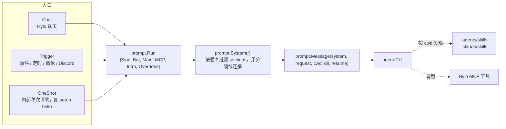
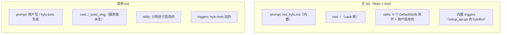
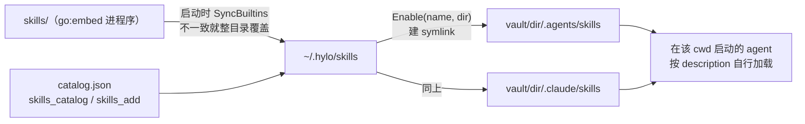
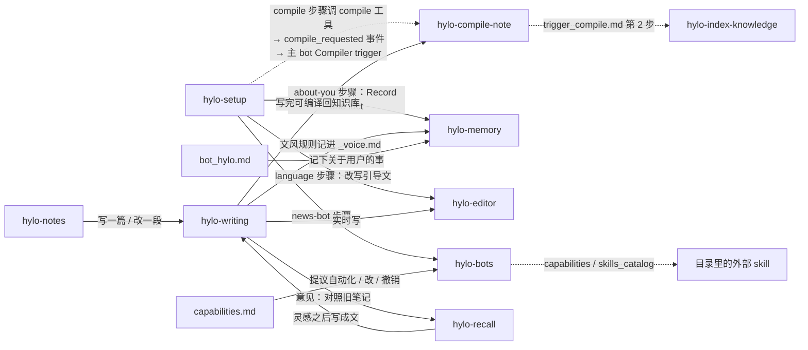
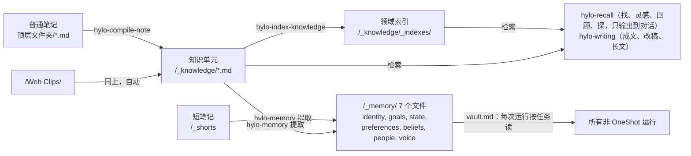
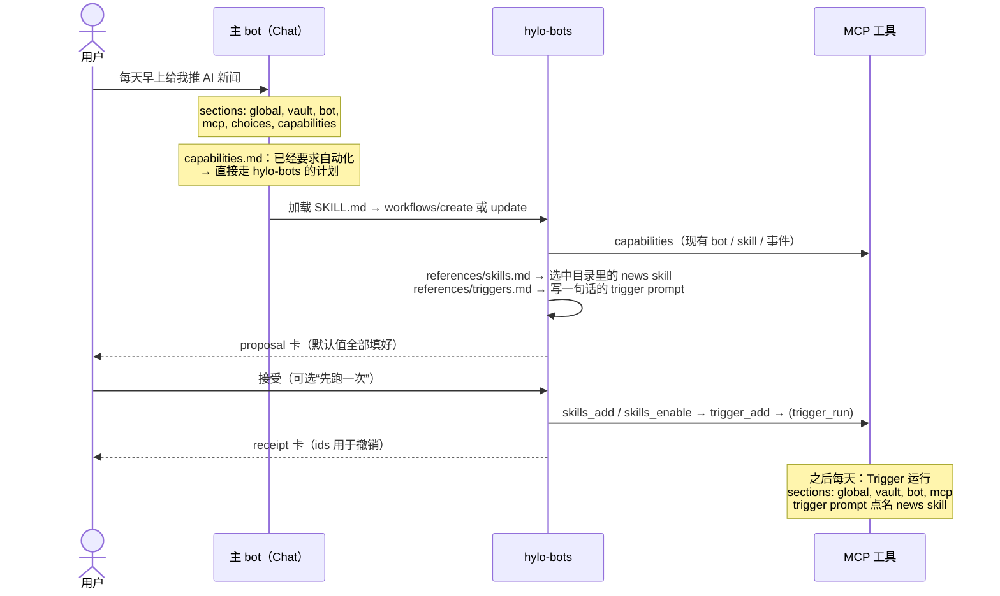

# Prompt + Skills 架构

Hylo 交给 agent 的指令分三层，各管一件事：

| 层 | 何时进入上下文 | 负责 | 源码 |
| --- | --- | --- | --- |
| **System prompt** | 每次运行的第一轮，按条件拼装 | 身份、vault 约定、该把请求交给谁 | `internal/prompt/` |
| **Skill** | agent 按 description 匹配到某项工作时才加载 | 这项工作怎么做 | `skills/`（内置，嵌进程序），`~/.hylo/skills`（运行时） |
| **MCP 工具** | 一直在工具列表里 | 真正读写 vault、管理 bot 和 skill | `internal/mcp/`（CLI 一一对应，见 `internal/cli/`） |

判断一段指令放哪一层：**每次运行都需要的放 prompt，做某件事才需要的放 skill，参数怎么填交给工具 schema。**

---

## 1. 一次运行怎么拼出指令



`executeChat`（`internal/server/handler/agent_api.go`）收集 `Run`：

- `Bot`：bot 存在 DB 里的 system prompt（调用方可覆盖）。
- `Main`：是不是主 bot。
- `MCP`：这个 agent 是否注入了 Hylo MCP。
- `Kind`：`oneShot` → OneShot，`TriggerRun` → Trigger，其余 → Chat。
- `Intro`：onboarding 后的第一次聊天。
- `Overrides[global]`：用户设置里的 `agent.system_prompt`。

`prompt.Message` 产出 agent 真正收到的第一条消息：

```
# Instructions

<system prompt>

---

Your working directory: <cwd> (the vault root | vault path /_bots/_xxx)

# User request

<用户消息 或 trigger prompt>
```

agent CLI 没有独立的 system prompt 参数，所以指令只随第一轮发送；**续聊（resume）只发用户消息**。改了 section 文本，已有会话不会生效，要新开会话才能验证。

---

## 2. System prompt 的 sections

定义在 `internal/prompt/sections.go`，从最通用到最具体依次排列。新增一层就是加一个条目。

| # | Section | 文本 | 生效条件 | 可覆盖 |
| --- | --- | --- | --- | --- |
| 1 | `global` | `text/global.md`：一句身份说明 | `Kind != OneShot` | ✅ `agent.system_prompt` |
| 2 | `vault` | `text/vault.md`：知识库路径、`[[ ]]` 链接规则、何时读哪些记忆文件 | `Kind != OneShot` | ❌ |
| 3 | `bot` | `Run.Bot`：主 bot 用 `text/bot_hylo.md`，其他 bot 由用户或 hylo-bots 写 | 非空即生效 | — |
| 4 | `mcp` | `text/mcp.md`：怎么用 Hylo 工具，按需局部读取（`extract_*`） | `MCP && Kind != OneShot` | ❌ |
| 5 | `choices` | `text/choices.md`：`choices` 按钮卡格式 | `Kind == Chat` | ❌ |
| 6 | `capabilities` | `text/capabilities.md`：内容层（方法、`sources` 卡、去向）+ 自动化阶梯 L0–L3 | `Chat && Main && MCP && Intro == nil` | ❌ |
| 7 | `intro` | `text/intro.md` 模板：启动 hylo-setup | `Intro != nil` | ❌ |

`global` 和 `vault` 分开，是因为 skill 和工具依赖的约定（链接写法、`_knowledge/_indexes/`、`_memory/`）不能被用户的个性化 prompt 冲掉。

### 各类运行实际拿到哪些 sections

| 运行 | global | vault | bot | mcp | choices | capabilities | intro |
| --- | :-: | :-: | :-: | :-: | :-: | :-: | :-: |
| 主 bot 聊天 | ✅ | ✅ | ✅ | ✅ | ✅ | ✅ | |
| 其他 bot 聊天 | ✅ | ✅ | ✅ | ✅ | ✅ | | |
| setup 首聊（主 bot） | ✅ | ✅ | ✅ | ✅ | ✅ | | ✅ |
| Trigger（含微信 / Discord 回复） | ✅ | ✅ | ✅ | ✅ | | | |
| OneShot | | | 有则 ✅ | | | | |

由此推出两点：

- **Trigger 运行没有 `choices`**：卡片只在 Hylo 聊天里渲染。所以 skill 里凡是要出卡片的地方，都要写明“在微信 / Discord 里改用纯文本”（hylo-bots `references/cards.md` 已经这样写）。
- **只有主 bot 会主动提议升级**：主 bot 是用户唯一的总入口，其他 bot 专职做一件事，不需要路由能力。

---

## 3. Bot 层



主 bot 的内置 triggers：每条 trigger prompt 就是这次运行的“用户请求”。

| Trigger | 事件 | Prompt | 走哪个 skill |
| --- | --- | --- | --- |
| WeChat | `wechat_message` | `[Message via WeChat]\n{Content}` | 无，由 `bot_hylo.md` 规定纯文本回复 |
| Discord | `discord_message` | `[Message via Discord]\n{Content}` | 同上 |
| Compiler | `compile_requested` | `trigger_compile.md` | 点名 hylo-compile-note → hylo-index-knowledge → humanizer（有就用） |
| Compiler | `note_created`，限 `/Web Clips/` | 同上 | 同上 |
| Memory | `scheduled`，daily 09:00 | `trigger_memory.md` | 不点名，靠 description 匹配到 hylo-memory |
| Recall | `short_note_created` | `trigger_recall_short.md` | 点名 hylo-recall（找：支持和矛盾）；没结果时只回 `[silent]`，不进收件箱 |
| Recall | `scheduled`，weekly mon 09:05 | `trigger_recall_weekly.md` | 点名 hylo-recall（周回顾） |

**Trigger prompt 的写法**（hylo-bots `references/triggers.md` + `references/skills.md`）：只写做什么、点名用哪个 skill、加上用户偏好（话题、数量、语言），不写方法。不写 curl、URL、API 参数，这些属于 skill。

---

## 4. Skill 层

### 4.1 怎么到达 agent



- **DefaultSkills**（`internal/skills/manager.go`）就是 `skills/embed.go` 嵌进程序的那些目录，在 `/` 常开、不能关：bots、compile-note、editor、index-knowledge、memory、notes、recall、setup、writing。每次启动和程序里的版本比对，不一致就整目录覆盖，用户改动不保留；手动链接进来的（开发时指向源码）不动。安装器不再复制 skill。主 bot 的 cwd 是 `/`，所以都能用；其他 bot 的 cwd 不在 `/`，默认一个都没有。
- **目录里的 skill**（`internal/skills/catalog.json`）：外部的 news、podcast、reading、writing 等。和内置 skill 职责重叠的不进目录（如 writing-beats、writing-shape 与 hylo-writing 重叠），免得两个 description 抢同一句话。要先 `skills_add`，再对某个 bot `skills_enable`。
- cwd 不是权限边界，它只决定 agent 能**发现**哪些 skill。

### 4.2 Skill 内部结构

都采用 Claude Code 的 skill 格式：`SKILL.md` 的 frontmatter `description` 决定什么时候被选中，正文做路由，具体内容放在子文件里按需读。

| Skill | 结构 | 职责 |
| --- | --- | --- |
| hylo-notes | 单文件 | 存哪、改删边界；查找交给 hylo-recall |
| hylo-editor | SKILL + `references/formats.md` | `editor_*` 工具怎么用；Hylo 的 markdown 方言。写什么归 hylo-writing |
| hylo-compile-note | SKILL + `references/{create,update}.md` | 一篇笔记 → 若干知识单元 |
| hylo-index-knowledge | 单文件 | 维护 `/_knowledge/_indexes/` 的领域索引 |
| hylo-memory | 单文件，两个任务 | 从近期短笔记和知识单元提取记忆；或记下一条事实 |
| hylo-recall | 路由 + `find.md` / `inspire.md` / `review.md` / `explore.md` | 找（资源、话题、观点、相关内容，不限时间）/ 灵感素材 / 回顾（周、月、随机翻历史）/ 探（按领域索引和文件树看全貌），只输出到对话 |
| hylo-bots | 路由 + `workflows/{create,update,delete,undo}` + `references/{cards,skills,system-prompt,triggers}` | 建、改、删、撤销 bot 和 trigger，挑选 skill |
| hylo-setup | 路由 + `steps/*`（intro → language → about-you → news-bot → compile → channels → wrap-up） | 首次引导，进度写在进度文件里 |
| hylo-writing | 路由 + `workflows/{draft,revise,longform}` + `references/{beats,forms,surface}` | 写作的统一入口：成文 / 改稿（意见、候选、替换）/ 长文；共用文风（`_voice.md`）、格式、落点三条规则 |

### 4.3 Skill 之间的依赖

实线表示文本里点名了另一个 skill，虚线表示通过工具或事件间接触发。



---

## 5. 数据流：笔记 → 知识 → 记忆



- **知识**：compile-note 负责写，index-knowledge 负责建索引，其他 skill 只读。读的时候先看索引，再看单元，再看原文，最后才全文搜索（`vault.md` 规定的顺序，所有运行共用）。每个单元的 `perspective`（own / external / mixed）由 compile-note 写入，memory 和 recall 据此区分“你写的”和“你读到的”。
- **记忆**：只有 hylo-memory 写。读的规则在 `vault.md`，所有运行共用。`_voice.md` 只记怎么写：后台只从短笔记学写法（短笔记是用户原样打出的字，知识单元经过编译改写），加上明确说过的规则和确认过的格式。写作时必读，衰减窗口 180 天。
- **hylo-memory 的提取规则**：自己写的内容可以提取身份、目标、观点等；外部来源只提取偏好。分辨内外靠知识单元的 `source_notes`，再对照 `_identity.md` 和 `_goals.md`。它常在后台 trigger 里运行，所以不向用户提问。

---

## 6. 聊天卡片协议

模型在回复里写一个带语言标记的 fence，聊天界面把它渲染成卡片（前端在 `editor/src/cm-live/fence-card/registry.js` 注册，`chat_text.js` 的 `FENCE_CARD_SEL` 与之保持一致）。

| 卡片 | 格式由谁定义 | 用途 | 交互 |
| --- | --- | --- | --- |
| `choices` | `text/choices.md` | 让用户在几个选项里选 | 点击后把选项文本作为用户消息发出，只有最新一条回复里的卡可点 |
| `sources` | `text/capabilities.md` | 列出这次用到的笔记和 skill | 笔记可点击；skill 可换成 `swap:` 里的候选 |
| `proposal` | hylo-bots `references/cards.md` | 自动化计划，接受即授权执行 | 摘要 + 可展开的细节 + 内嵌 choices |
| `receipt` | hylo-bots `references/cards.md` | 执行回执；`ids` 记下做了哪些改动 | 撤销按钮发送撤销文本，由 hylo-bots `workflows/undo.md` 按 `ids` 从后往前回滚 |

卡片只在 Chat 里渲染。Trigger 运行没有 `choices` section，在微信 / Discord 里一律用纯文本。

---

## 7. 一次请求的完整路径

以在主 bot 聊天里说“每天早上给我推 AI 新闻”为例：



---

## 8. 每类约定只有一个归属

改某个约定时只改它的归属文件，其他地方只引用，不复述。

| 约定 | 唯一归属 |
| --- | --- |
| `[[ ]]` 链接、知识库路径、怎么读记忆 | `text/vault.md` |
| 怎么写记忆（含何时加 `pinned`） | hylo-memory 的 “Record one fact” |
| 局部读取（`extract_*`） | `text/mcp.md` |
| `choices` 卡格式 | `text/choices.md` |
| `sources` 卡格式、升级阶梯 L0–L3 | `text/capabilities.md` |
| `proposal` / `receipt` 卡格式 | hylo-bots `references/cards.md` |
| 用 skill 还是直接写 prompt | hylo-bots `references/skills.md` |
| 检索顺序、`perspective` 的含义 | `vault.md` |
| 笔记存哪 | hylo-notes |
| Markdown 方言 | hylo-editor `references/formats.md` |
| 工具参数 | MCP 工具 schema（`internal/mcp/`） |

---

## 9. 已知耦合

- **Trigger prompt 靠 skill 名字耦合**：`trigger_compile.md`、`trigger_recall_*.md` 直接写 skill 名。`TestHyloBotTriggersAreValid` 检查主 bot 的 prompt 里出现的 `hylo-*` 都是内置 skill；内置 skill 改名时，在 `skills.Retired` 登记旧名，启动时会改写数据库里各 bot 和 trigger 存的 prompt 副本。
- **“找不到工具就搜 deferred tools”在每个 skill 里重复一遍**：在 vault 目录里直接启动 Claude Code 时没有 Hylo 的 system prompt，只能靠这句话找到工具。这是有意保留的；改 MCP server 名时要和 `mcp.md` 一起改。
- **“存哪”只在 hylo-notes 定义**：`bot_hylo.md` 只说“交给 hylo-notes，不问存哪”；hylo-writing 只保留一句“自己挑顶层文件夹”。改存放规则时改 hylo-notes 的表。
- **section 文本只随第一轮发送**：改 prompt 后要新开会话验证，见第 1 节。
