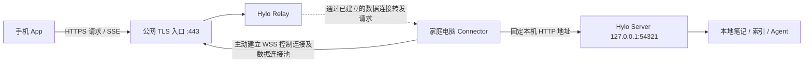

# Hylo 手机远程访问与 Relay 架构设计

状态：设计提案，尚未实现。

实施状态：Relay、家庭 Connector 和普通 HTTP/SSE 隧道已开始实现；手机端、扫码配对、设备授权、内层 TLS 和多节点仍未实现。当前部署方法见 [relay-deployment.md](relay-deployment.md)。

## 1. 目标与范围

手机 App 连接公网 Relay，访问家庭电脑上的 Hylo Server。家里不需要公网 IP、端口映射或修改路由器；笔记、索引、模型凭据和 agent 执行环境继续留在家里的电脑上。

这里的“手机流量”指 App 发往 Hylo 的 HTTP 请求，包括 API、文件和 SSE，不接管手机其他应用的网络流量，也不开放家庭局域网的任意服务。

第一版假设 Relay 部署在用户自己管理、可以信任的公网服务器上。采用分段 TLS，Relay 能读取请求内容和 Hylo 凭据；如果产品需要运营方无法读取用户数据，应改用第 11 节的端到端方案后再上线。

## 2. 现有代码与约束

- `internal/server/router.go` 提供 HTTP API，包括 `/api/runs`、`/api/runs/{id}/events`、`/api/live` 和上传下载接口。
- `internal/server/middleware/auth.go` 支持 `X-Hylo-API-Key`、Bearer 和浏览器 Cookie；API key 为空时不启用认证。启用远程连接必须要求非空 API key。
- `internal/agent/hub.go` 的 run SSE 已解析 `Last-Event-ID`，可以复用事件补发能力；其可恢复范围仍受内存事件保留和进程生命周期限制。
- `docs/remote-deployment.md` 已采用本机监听、HTTPS 反向代理和禁用流缓冲的部署方式。
- Hylo 的 agent 可以使用本机工具，因此远程凭据代表很高的权限，不能把 server ID 当作认证凭据。

设计保留这些 HTTP 语义，不把每个业务 API 重新包装成 WebSocket RPC。

## 3. 总体架构



连接由家庭电脑主动向外建立，业务请求沿这些连接反向进入家庭电脑。手机端仍使用普通 HTTPS，接收普通 HTTP 响应或 SSE。

| 组件 | 职责 | 持久状态 |
| --- | --- | --- |
| 手机 App | 保存连接配置、发起业务请求、恢复事件订阅 | Relay 地址、server ID、手机设备凭据、Hylo API key |
| Relay | 设备认证、server 路由、反向连接分配、限流 | server 注册、设备凭据摘要、授权和吊销记录 |
| Connector | 主动连公网、维护连接池、将字节流连接到固定 Hylo 地址 | Relay 地址、server ID、Connector 独立凭据 |
| Hylo Server | 原有 API、鉴权、业务执行与数据管理 | 现有本地数据 |

Connector 在逻辑上独立，建议由 Hylo 服务进程管理其生命周期；具体隧道模块不依赖 agent、笔记存储或 HTTP handler。公网 Relay 使用独立二进制，不加载业务模块。

## 4. 传输方案

### 4.1 选择：WSS 控制连接 + 预建立的数据连接池

第一版使用 WSS over TCP 443，以便复用 TLS 入口。网络代理仍可能禁止 WebSocket，部署时必须验证升级和长连接配置，不能承诺所有网络都可用。

控制连接负责注册、会话、心跳、连接池补充和下线通知。数据连接只承载 HTTP 字节流，避免大文件或慢速 SSE 阻塞控制消息。

每条数据连接对应一条 Relay 到 Hylo 的逻辑 TCP 连接：

```text
手机 HTTP 请求
  → Relay 认证和路由
  → ReverseProxy / HTTP Transport
  → 已认证且空闲的反向数据连接
  → WebSocket 二进制消息承载连续字节流
  → Connector 固定连接本机 Hylo
  → Hylo 原有 HTTP handler
```

Relay 的 HTTP Transport 通过自定义拨号器取得反向连接；拨号器必须按 server 和会话隔离，禁止不同 server 共享 HTTP 连接池。隧道侧使用 HTTP/1.1，复用成熟的 HTTP 解析、分块传输和 keep-alive。

WebSocket 消息边界不代表 HTTP 请求边界；适配层向 Transport 提供连续流和截止时间。正常完成按 HTTP 长度或分块结束判断；连接关闭映射为 EOF，异常中断不得伪装为完整响应。

首版不支持 HTTP CONNECT 和业务 WebSocket Upgrade，明确返回不支持错误。未来需要时单独定义双向关闭语义并补齐测试；现有 API 和 SSE 不依赖这些能力。

### 4.2 连接分配与背压

- 初始预建立 4 条空闲数据连接，最多 16 条已分配连接；数值是初始配置，需要压测调整。
- Relay 取走空闲连接时，通过控制连接通知 Connector 补充。Connector 只在分配后打开本机 Hylo 连接，避免空闲隧道占用 Hylo 连接资源。
- 一个 SSE 订阅会长期占用一条连接；HTTP/1.1 不在同一连接上并行不同请求。
- 已分配连接可顺序复用；长连接计入总配额，空闲 HTTP 连接有回收期限，防止连接池耗尽。
- 控制和数据分别设置连接数、帧大小和缓冲区上限；数据按小块流式复制，禁止将整个上传、下载或 WebSocket 消息无上限读入内存。
- 手机读取慢时，通过有限缓冲和 TCP 背压约束内存。达到并发上限时短暂等待，超时返回 `429 relay_busy`，不无限排队。

初期每条数据连接独立承担传输和故障，暂不自研多路复用协议。未来连接规模确实成为瓶颈时，再评估成熟的多路复用实现或 QUIC。

## 5. 身份、配对和授权

### 5.1 两层独立认证

1. Relay 认证：Connector 凭据只能注册指定 server；手机设备凭据只能访问被授权的 server。二者不可互换。
2. Hylo 认证：手机继续发送 `X-Hylo-API-Key`，由家里的 Hylo 校验。Relay 不代替 Hylo 认证，也不向未通过 Relay 认证的请求开放 `/healthz` 等业务路径。

原生 App 可用 `Authorization: Bearer <relay-device-token>`，由 Relay 校验并剥离，再将 `X-Hylo-API-Key` 传给 Hylo。这样避免 Relay 和 Hylo 争用同一个 Authorization 头。设备凭据不出现在 URL、查询参数或访问日志中。

Relay 设备凭据为高熵随机值，服务端只持久化不可逆摘要，支持单设备吊销。Connector 使用单独的高熵随机凭据，并支持轮换；不能复用管理员凭据或 Hylo API key。

### 5.2 第一版配对流程

家庭端视为可信环境，用户主动展示二维码即表示授权持码手机连接。手机扫码自动完成配置、设备登记和首次连接，不输入 API key，不核对验证码，也不要求家庭端二次确认。Relay 的部署注册属于一次性环境配置，不出现在每次手机配对流程里。

1. 用户在家庭桌面端点击「连接手机」，Connector 创建默认两分钟有效、单次使用的配对邀请。
2. 家庭端展示二维码，包含协议版本、环境名称、Relay 地址、server ID、家庭身份公钥指纹、配对邀请秘密和 Hylo API key。
3. 手机扫码，校验二维码结构与地址，通过 Relay 建立连接。在第 11 节的端到端模式下，先固定二维码中的家庭身份，再通过内层 TLS 提交配对邀请和手机公钥；API key 不发给 Relay。
4. 家庭端自动校验并原子消费邀请，登记手机身份，返回设备授权。并发兑换只能成功一次。Relay 所需的设备接入凭据由 Connector 使用自身受限注册权限自动申请，不把 Connector 凭据交给手机。
5. 手机将连接配置、API key 和设备凭据保存到系统安全存储，自动访问 Hylo 状态接口，成功后直接进入家庭环境。家庭端显示「手机已连接」，无需操作。

配对邀请绑定 server、有效期与一次成功登记的手机公钥；短时保存该登记结果，让同一设备在响应丢失时能恢复配对，其他设备不能重用。二维码过期、窗口关闭或邀请消费后，旧邀请不再允许新增设备；取消窗口与兑换之间的竞争由家庭端原子状态转换决定。

二维码使用 App 内部识别的版本化载荷，不把 API key 放进普通 HTTPS URL 的查询参数；只在家庭端按需显示，不写日志、不上传第三方二维码服务。手机对不支持的版本或非安全 Relay 地址明确报错，家庭身份变化时要求重新扫码。

安全边界：持有有效二维码就获得配对权，不再有人工审批。二维码包含长期 API key，邀请过期或单次消费不能使已拍摄的 API key 失效；API key 泄露时必须轮换。不要把二维码宣传成“全部内容两分钟后失效”。端到端设备认证可阻止仅持有旧 API key 的未配对手机通过该隧道接入，但不能撤销该 key 在其他可达 Hylo 入口上的权限。

吊销手机 Relay 凭据时，Relay 必须中断该设备正在进行的请求和 SSE，而不只是拒绝新请求。Hylo 当前 API key 为共享凭据，不能单独吊销一台手机的本地访问权限；若怀疑泄露，需轮换 Hylo key。完整的每设备业务凭据属于后续 Hylo 鉴权改造。

## 6. 公网接口与请求路由

下列为拟议接口，不代表现有命令或配置已经实现：

| 接口 | 调用方 | 用途 |
| --- | --- | --- |
| `WSS /relay/v1/control` | Connector | 认证、注册会话、维护在线状态 |
| `WSS /relay/v1/data` | Connector | 提交属于当前会话的数据连接 |
| `HTTPS /s/{server_id}/api/...` | 手机 | 转发对应 Hylo API |
| `GET /relay/v1/servers/{server_id}/status` | 已授权手机 | 查询 Connector 在线状态，不等同 Hylo 健康状态 |
| `GET /healthz` | 运维 | 仅报告 Relay 进程健康 |

数据连接须同时验证 Connector 身份、server ID、会话 ID 和连接配额。控制连接注册成功后才接受数据连接；会话替换后，旧会话不能继续补充或接收连接。

手机设置 `baseURL=https://relay.example.com/s/{server_id}`。Relay 只去掉已校验的前缀，例如将 `/s/abc/api/runs` 转为 `/api/runs`。保留查询参数、请求体、状态码及有效端到端响应头。

Relay 校验设备对 server 的授权后，才查询和分配隧道。无授权时不泄露目标是否存在；已授权但离线时返回明确的离线错误。

首版仅开放手机需要的、显式声明的方法和 API 路由清单；配置修改、重启、开发接口、`/mcp` 等高权限入口默认不开放。清单应复用实际注册路由元数据，匹配解码后的规范路径并拒绝含糊编码，避免与 Hylo 路由器产生不同解释。

Connector 的目标由家庭本机配置固定为 `127.0.0.1:<Hylo端口>`，禁止从公网请求指定目标主机、端口或 URL，也不跟随到任意主机的代理重定向。

第一版面向原生 API 客户端，不直接承诺完整 Web UI：现有根路径链接、登录跳转、Cookie Path、OAuth 回调与子路径部署还需单独适配。业务响应中的内部绝对 URL 或重定向也需要验收，不能假设加一层前缀后自动兼容。

## 7. SSE、重连和任务语义

### 7.1 SSE 全链路保持流式

- 公网 TLS 入口、Relay 和 Connector 均不得缓冲完整响应；响应头和事件及时刷新。
- 透传 `Content-Type: text/event-stream`、事件 ID 和 `Last-Event-ID`，禁止缓存。
- 长流不套用短的全局响应写超时，分别管理建连、响应头等待、上传和流存活；心跳策略须覆盖各层代理空闲超时。
- WebSocket Ping/Pong 只能维持隧道这一段，不能替代手机到公网入口这一段所需的 SSE 心跳。

Go ReverseProxy 对 SSE 有立即刷新的行为，但入口代理也必须配置为不缓冲。参见 [Go ReverseProxy 文档](https://pkg.go.dev/net/http/httputil#ReverseProxy)。

### 7.2 手机网络切换

手机从 Wi-Fi 切到蜂窝网络后，重建 HTTP 连接，并使用最近收到的事件 ID 重新订阅。不要假装旧连接可以迁移，也不要在 Relay 缓存业务事件。

对于可脱离请求执行的任务，使用 `/api/runs` 创建任务后通过 run ID 订阅事件；恢复时先查 run 状态，再补订阅。现有 SSE 补发能力应验证顺序、重复事件处理和保留范围。Hylo 重启或事件被清理后，通过持久会话状态重新同步。

不能自动重发“创建任务、写笔记、调用工具”等不确定是否已提交的写请求。首版遇到断线显示“结果待确认”，通过已有 run 查询与业务状态核对。若要自动安全重试，需要 Hylo 在业务提交事务内实现按用户、操作和幂等键去重；Relay 生成 request ID 无法提供该保证。

### 7.3 家庭连接中断

Connector 控制连接建议每 20 秒 Ping，60 秒没有有效存活信号则结束会话；参数可配置。WebSocket Ping/Pong 依据 [RFC 6455](https://www.rfc-editor.org/rfc/rfc6455)。

控制会话失效后，Relay 将 server 标为离线并终止该会话的数据连接，行为保持一致。Connector 以指数退避加随机抖动重连，建议从 1 秒递增至最多 30 秒，连接稳定一段时间后重置退避。

为每次注册生成新的 session ID。注册替换采用原子操作，旧会话清理必须检查 session ID，防止旧连接退出时删掉新会话。单 server 仅允许一个活动 Connector；多实例高可用另行设计租约。

家庭电脑休眠或关机时无法访问；Relay 不保存家庭数据，也不能远程唤醒没有额外唤醒通道的电脑。已有 agent 任务是否继续由 Hylo 的任务生命周期决定，不能把“订阅断开”和“取消任务”混为一谈。

## 8. 错误和安全边界

| 场景 | 行为 |
| --- | --- |
| Relay 设备凭据无效 | `401 relay_unauthorized` |
| 无该 server 授权或目标不可见 | `404 server_not_found` |
| 已授权，Connector 离线 | `503 home_offline` |
| Connector 在线，本机 Hylo 不可达 | `502 home_unreachable` |
| 等待连接或容量不足 | `429 relay_busy`，附重试建议 |
| 业务响应头超时 | `504 home_timeout` |
| Hylo 返回认证失败或业务错误 | 保留 Hylo 原状态与响应体 |
| 已发送响应头后隧道中断 | 终止响应，由客户端检测不完整流，不能改写成 JSON 错误 |

Relay 自身生成的错误使用固定 JSON envelope 和 request ID，业务响应不重新包装。Hylo 健康错误可通过 Connector 控制通道报告关联连接 ID，但不得泄露本机敏感信息。

Relay 删除客户端传入的转发身份头、逐跳头和内部控制头，再按可信来源生成必要头。由于 Hylo 信任本机来源的 `X-Forwarded-For` 与 `X-Forwarded-Proto`，Connector 是信任链的一部分；这两个头不能原样接受手机的声明。原生 App 首版不依赖浏览器 Cookie 或这些头进行权限判断。

公网只开放 443，管理员通过 SSH/本机 CLI 操作；管理接口不复用公开业务路径。日志禁止记录请求体、笔记、凭据、Cookie 与完整敏感查询参数，凭据文件限制访问权限。配置 TLS、请求头大小、上传大小、设备速率、server 并发、全局连接数和带宽配额。

## 9. 部署与运维

首版部署：一台公网服务器、一个域名和证书、一个 TLS 入口、一个 Relay 进程、SQLite 元数据存储。入口与 Relay 同机通过 loopback 通信；容器部署时使用受隔离的私有网络。SQLite 不存业务内容。

家庭侧随 Hylo 启动 Connector，由桌面程序或系统服务负责异常重启。移动端仅在使用时连接，后台推送另行集成 APNs/FCM，不依赖手机长期后台保活。

监控至少包括在线 Connector 数、每 server 数据连接数、设备活跃请求、隧道重连次数、拨号等待、首字节耗时、SSE 异常断开和转发字节数。审计记录设备配对、吊销、Connector 轮换和异常认证，不记录业务内容。

Relay 重启会断开现有流，家庭 Connector 和手机分别重连。首版接受这一可用性边界；更新前停止分配新请求并限时排空，超时后结束长流。

扩容时，持有 Connector 的节点才有实际数据连接，不能仅靠 Redis 在线状态就让任意节点转发。下一阶段需要明确选择 server 到节点的固定路由，或节点间转发，并设计会话租约和单节点失效处理；首版不引入这部分复杂度。

所有业务字节都经过公网服务器，其带宽与家庭上行会影响体验。下载速度受家庭上行限制；Relay 的流量计费须按实际供应商的入站、出站和双向统计方式估算。

## 10. 代码组织与实施顺序

拟议模块：

```text
cmd/hylo-relay/          公网服务入口
internal/relay/          注册、认证、路由、反向连接池与代理
internal/relayproto/     版本协商、控制消息、WSS 字节流适配
internal/connector/      家庭出站连接、心跳、重连和固定目标桥接
```

Hylo 配置增加显式开关、Relay URL、server ID、Connector 凭据引用、池大小和本机目标；凭据使用受保护文件或系统安全存储，不进入可被普通配置接口返回的字段。配置校验拒绝远程明文地址、空 Hylo API key 和非允许目标。服务关闭时取消 Connector 生命周期。

实施分三步：

1. 打通单 server、手动凭据、双层认证、普通 HTTP、SSE 和上传下载，完成单机部署说明。
2. 加入桌面配对、手机安全存储、设备吊销、断线恢复、配额和基本运维指标，形成日常可用版本。
3. 根据实际产品边界补充每设备 Hylo 认证、端到端加密、后台推送和多节点能力。

验收必须覆盖：无端口映射的家庭网络、并发 SSE 与大文件、慢客户端内存上限、手机取消与超时释放、非幂等写入中途断线、事件补发、家庭休眠恢复、Relay 重启、旧会话退出竞争、凭据吊销立即生效、跨 server 隔离、伪造转发头和路径编码绕过。

## 11. 端到端加密的升级路径

如果 Relay 由产品运营方或不可信第三方管理，推荐把端到端加密作为上线前提。两段 HTTPS/WSS 只防止链路窃听，不能防止 Relay 读取甚至修改业务数据。

可保留现有控制通道和反向连接池，在手机与家庭 Connector 之间建立内层 TLS。家庭端生成持久身份密钥，手机在现场配对时固定家庭公钥；Relay 只负责授权、选路和透传加密字节，无法获得 Hylo API key。密钥轮换或家庭身份变化必须重新受信确认，不能只接受 Relay 返回的新公钥。

这需要手机网络层支持经 Relay 建立的字节流，并在其上完成内层 TLS 与 HTTP；Relay 数据面也要从解析 HTTP 的反向代理改为授权后的透明隧道。不能仅通过配置开关把第一版升级为端到端方案。路由元数据、在线状态和流量大小仍会暴露给 Relay，设备业务授权仍必须由家庭端执行。

因此本提案选择：自托管可信 Relay 先完成 HTTP 反向隧道；若预期是面向多用户运营的公共服务，应在实现前改为内层 TLS 的数据面设计。
